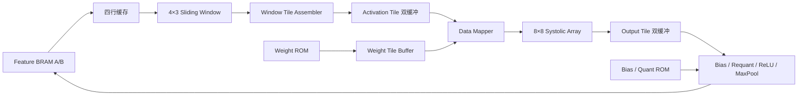

# 基准方案：单层 CNN 卷积引擎

实现入口：`rtl/cnn_layer_accelerator.v`。纯 Verilog 可综合 RTL；SystemVerilog 仅用于 testbench。
目标器件：现有工程的 PYNQ-Z2 / xc7z020clg400-1。计算范围是一层 Conv + Bias + Requant + ReLU + MaxPool。
同一个引擎支持导出的 Conv1、Conv2、Conv3；GAP、FC 和 PS/AXI 集成不属于本次单层范围。

## 与基准方案逐项对应

| 基准模块 | 文件 / 实现 |
|---|---|
| Feature BRAM A/B | `memories.v` / 两块 8192×8 同步读写 BRAM，无数组复位 |
| Weight / Bias / Quant ROM | `memories.v` / 8192×8、64×32、64×32；由导出整数初始化 |
| cnn_controller | `cnn_controller.v` / 锁存层配置，加载参数，逐 OC 组运行，等待最终写回 |
| tile_controller | `tile_controller.v` / Prep、Array、Post 独立工作，双缓冲所有权管理 |
| line_buffer | `prep.v` / 四条行缓存，每条保存当前 Tile 所需的六列（包含 halo） |
| 4×3 Sliding Window | `prep.v` / 四行三列移位寄存器，生成上下两个 3×3 窗口 |
| window tile assembler | `prep.v` / 一拍将上下两个完整 3×3 窗口写入两个空间列 |
| Activation Tile Buffer | `memories.v` / 逻辑两组 144×8 INT8；物理按九个 tap×八个空间 lane 分 bank，每个 bank 深度 16 |
| Weight Tile Buffer | `memories.v` + `weight_loader.v` / 8×144 INT8，当前 OC 组保持不变 |
| Data Mapper | `data_mapper.v` / 同步读缓存、按行列编号错拍、传播 valid/last |
| PE / Systolic Array | `mac_pe.v`、`systolic_array.v` / 64 个 output-stationary PE |
| Output Tile Buffer | `memories.v` / 两组 64×INT32，整 Tile 快照 |
| post-processing | `post_processing.v` / Bias、INT64 乘法、舍入、饱和、ReLU、池化、写回 |

## Tile 与扫描选择



采用基准方案中的逐空间 Tile 准备方式，外循环是八个输出通道组成的 OC 组。
每个 Tile 内依次处理所有输入通道，切换通道时重新加载该通道四行所需片段。
这是四条短行缓存加真实 4×3 滑窗：数据并非绕过滑窗直接送入阵列。
一行片段有六列，前三列建立滑窗，再右移三次，共产生四个有效水平位置。
相邻水平窗口复用两列；首版不复用跨 Tile 的 halo，换 Tile/通道会重新装载。

```
空间位置： P0 P1 | P4 P5
           P2 P3 | P6 P7

滑窗位置 0：上下窗口写 P0/P2
滑窗位置 1：上下窗口写 P1/P3
滑窗位置 2：上下窗口写 P4/P6
滑窗位置 3：上下窗口写 P5/P7
```

每输入通道在 K 方向占九项：`k=ic*9+ky*3+kx`。
`W[8×K] × X[K×8] = Y[8×8]`，K 为 9、72、144。
只有完整 K 项累加结束才做后处理，bias 每元素只加一次。
每个 Tile 经池化产生 8 通道×2 点，共 16 个 INT8。

## 时钟与存储时序

全设计只有 `clk`，交付工作频率为 50 MHz（20 ns）。`rst` 是高有效同步复位，保持至少一个上升沿。
没有门控时钟、逻辑分频、跨时钟域或多周期/false-path 豁免。
复位丢弃正在执行的任务；Feature RAM 内容不清空，必须重新启动一层。

Feature RAM / 参数 ROM 在读使能有效的上升沿采样地址，沿后更新读数据。
Prep 在 STREAM 中连续 24 拍产生当前通道四行×六列的地址，每拍产生一个位置。
地址及 row/col/padding/valid 先寄存；下一沿 BRAM 采样请求，同时寄存返回标签；再下一沿按标签写入行缓存。
三者重叠，稳态每拍写一个位置；最后用两拍 DRAIN 等待在途返回写完。
Padding 仍是有效的零数据 token，但不发越界 RAM 读取，不会误用前次 RAM 读出的旧数据。
Weight Loader 同样把地址计算、请求和返回数据存储分开。

滑窗只在 `step` 有效时更新；六列连续移入，前两列预热，随后每拍产生一对窗口，共四对。
Assembler 将一对窗口的 18 个 INT8 同时写入独立的 tap/lane bank：每个物理 bank 每拍仍只有一个写地址。
所有 bank 以输入通道为地址，因此无需九拍循环复制。最后一对窗口写入后才结束该通道或宣布 Prep 完成。
每通道用 24 拍 STREAM、2 拍 DRAIN、1 拍清窗、6 拍 SHIFT、1 拍 FLUSH；每 Tile 的阶段占用为 `34*Cin+1` 拍，另一个周期用于完成握手。
Activation Buffer 和 Weight Buffer 每个读取拍输出八个 INT8，读取延迟均为一拍。
Mapper 在原线性 K 地址之外维护 ic/tap 计数器，满足 `k=ic*9+tap`，避免组合除以九或求余的长路径。
激活缓存从对应 tap/ic 选择八个空间 lane 后寄存输出；阵列读接口及有效数据顺序保持一致。
Mapper 的 valid/last 随同步读延迟走一拍，再经 lane i 的 i 拍额外错位。
权重向右、激活向下传播，每个 PE 对齐同一 k 的操作数。
右下 PE 的最后一次有效累加标记阵列完成；下一上升沿把全部结果快照写入 Output Buffer。
该边沿后才释放 Activation Buffer，下一 Tile 清零 PE 不会破坏上一 Tile 输出。

Post 从 Output Buffer 同步读一个 INT32，依次进行 Bias、乘法、绝对值、舍入、饱和、ReLU。
正负数均执行 half-away-from-zero；饱和范围严格为 [-127,127]。
舍入使用 `(magnitude >> 31) + magnitude[30]`，等价于 `(magnitude+2^30)>>31`。
输出通道对应的 bias/multiplier 在整组空间 Tile 期间不变。
本模型三个卷积层导出的 shift 全部为 31，因此 RTL 将 shift 固定为 31，Quant ROM 保存逐输出通道 multiplier。
导出脚本逐项断言 shift==31；若以后换模型出现其他 shift，必须扩展 RTL 与参数格式，不能直接沿用本实现。
每四个值生成一个池化值并写入目的 BRAM；最后一次写入后才产生 post_done、group_done、layer done。

## 双缓冲与流水线

Activation full 从 Prep 完成保持到 Array 完成；Output full 从 Array 完成保持到 Post 完成。
每一阶段均有自己的 active 状态和 bank 指针。启动时先确认输入已完成、输出 bank 空闲。
慢 Post 会反压 Array，慢 Array 会反压 Prep；没有覆盖未消费数据。
OC 组切换前排空当前组，因此不会用新参数处理旧输出。

三级是任务级流水线，不代表三阶段都只用一拍或长期同速。
经过连续 BRAM 读取及并行窗口写入优化，Prep 每 Tile 为 35/273/545 拍；单路 Post 仍为 593 拍，成为当前主要吞吐限制。
双缓冲允许阶段重叠，但不能消除持续吞吐瓶颈；不能按 64 MAC/拍推算整层实测吞吐。

## 顶层接口

所有输入由 `clk` 同步驱动。在空闲时配置 `cfg_*`，给 `start` 一个周期脉冲。
配置在接受 start 的沿锁存；busy 时再次 start 被忽略。
done 为一个周期脉冲，表示最终池化结果已经写回；error 在非法配置时置位，到下一次请求清除。
非法请求产生 done+error，不启动计算。busy 为 1 时不可访问 host RAM 接口。

| 参数 | Conv1 | Conv2 | Conv3 |
|---|---:|---:|---:|
| cfg_cin | 1 | 8 | 16 |
| cfg_cout | 8 | 16 | 32 |
| cfg_height / cfg_width | 64 | 32 | 16 |
| cfg_weight_base | 0 | 72 | 1224 |
| cfg_bias_base / cfg_quant_base | 0 | 8 | 24 |
| 常用 cfg_src → cfg_dst | A→B | B→A | A→B |
| 输入字节数 | 4096 | 8192 | 4096 |
| 池化输出字节数 | 8192 | 4096 | 2048 |

bank 0=A，1=B，源和目的必须不同。input_base/output_base 为字节地址，默认 0。
权重地址单位是一个 INT8；bias/quant 地址单位是一个 INT32。
只接受上述三种形状，并检查内存边界；可改变 bank 和合法基地址。

`host_ready=1` 时可读写指定 bank 的 host_addr。start 与 host 访问应分开周期，若同时发起则 start 优先。
写：host_wr_en、host_bank、host_addr、host_wr_data 在上升沿被接受。
读：host_rd_en 在上升沿 E0 被接受，BRAM 在 E0 后更新内部读数据；E1 后寄存器输出 host_rd_valid 和 host_rd_data。
即接口具有两拍读流水，支持连续每拍请求。复位或 start 沿后 ready 清零，busy 期间 host 请求被忽略。
done 后额外经过一个空闲周期，host_ready 才重新置位；外部须等待 ready 后开始读回。
同地址同拍读写是 RTL read-first 语义；常规软件流程应分开装载与读回。
host 是原生同步调试接口，尚不是 AXI。

## 验证入口

在项目根目录运行：

```powershell
& 'D:\programm\anaconda\envs\vision_attention\python.exe' scripts/export_vectors.py
powershell -NoProfile -ExecutionPolicy Bypass -File scripts/run_sim.ps1 -Test array
powershell -NoProfile -ExecutionPolicy Bypass -File scripts/run_sim.ps1 -Test post
powershell -NoProfile -ExecutionPolicy Bypass -File scripts/run_sim.ps1 -Test layer
& 'D:\Vivado\2023.2\bin\vivado.bat' -mode batch -source scripts/implement.tcl -log build/implementation.log -journal build/implementation.jou
powershell -NoProfile -ExecutionPolicy Bypass -File scripts/run_timing_sim.ps1
```

`export_vectors.py` 只转换已有整数文件格式，不重新量化。`data/manifest.json` 保存来源 SHA256。
array 测试检查六次 Tile、K=9/72/144、正负激活和权重。
post 测试检查正负半值、正负饱和、零乘数、bias、池化与地址。
layer 测试使用 0000_y0、0399_y1 两个 golden 样本；检查每个累加结果、每个输出写地址及最终 RAM 读回。
样本 0 连续运行三层且不重装中间输入；样本 1 独立装载，反转 bank 并使用非零基地址。
另外检查非法配置、运行中复位（含读请求/返回同时在途）、busy 时重复 start/host 写入和流水重叠。
还检查窗口对写入数量、连续地址 token 数量，以及 Mapper 的线性 K 与 ic/tap 一致性。
带布线延迟仿真默认检查首个 Tile 的 16 个输出及实际 BRAM 读回；完整层正确性由上述 layer 测试覆盖。
详细覆盖范围和已通过结果见 `docs/verification.md`。

物理时序在器件上执行含 IBUF/OBUF/BUFG 的完整综合、布局、布线，20ns 时钟、0.2ns uncertainty，
输入/输出外部预算 max=2ns、min=0.5ns，见 `constraints/core_50mhz.xdc`。
`scripts/pre_opt.tcl` 将两块 Weight ROM BRAM 排除在自动省电使能重写之外，保留 RTL 读使能。
这是因为一次布局结果的自动 `cooolgate` 使能逻辑在 SDF 中触发保持违例；实现脚本和 GUI impl_1 的 pre-opt hook 均应用此设置。
所有建立/保持时序检查仍开启，没有增加 false-path 或 multicycle 例外。
本次没有 PS 与板级引脚分配，I/O 位置由工具自动安排，仅用于完整的物理时序验证；不生成可上板 bitstream。
未来接入 PS/AXI 时应把该模块置于系统内部，使用系统时钟、接口约束及实际板级 XDC，重新验证最终时序。
初始 100MHz 目标未通过含 I/O 的完整时序，交付不声称支持 100MHz。
