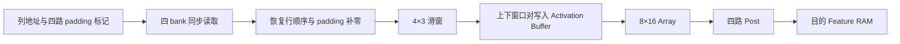

# 按列流式 Prep 与四路 Feature BRAM 读取

本次按顺序完成两步：先实现单路按列读取并验证六次整层 CNN，再保存该版本，随后实现四 bank 同拍读取一列。保持原始 INT8 权重、bias、逐通道 multiplier、舍入、饱和和 golden 数据。

## 两步实现

第一步把按行加载完整 4×10 区域改为 `row0,col0 → row1,col0 → row2,col0 → row3,col0 → row0,col1…`。前三个返回值保存在三个字节寄存器，第四个值返回时立即组成一列推进 4×3 滑窗。窗口生成与后续 BRAM 请求重叠，不再单独执行十拍扫描。每通道 1 拍清窗、40 拍请求、3 拍返回/末窗提交，Prep 占用 `44*Cin+1` 拍。

第一步完整源码、testbench、脚本和六次 CNN PASS 日志保存在 `build/column_stream_single/`。修改前版本保存在 `build/before_column_stream/`。只有第一步六次整层全部通过后才开始第二步。

第二步在 `rtl/memories.v` 中将每块逻辑 8192×8 Feature RAM 划为四个物理 2048×8 bank。对逻辑地址 `a` 和图像宽度 `W`：

```
q = floor(a / W)
x = a % W
bank = q % 4
bank_address = floor(q / 4) * W + x
```

连续四行的同一列分别落在四个 bank，因此每拍可以读取四个 INT8。映射包含绝对基地址，支持不是行边界的基地址；并非简单假设 Tile 顶行总在 Bank 0。每个返回 lane 的 bank 选择随请求寄存，输出恢复上到下的行顺序。

支持宽度 64/32/16/8，地址计算为取位拼接。Prep 使用输入宽度读取；Post 使用池化输出宽度写入。每块 Feature RAM 记录最近写入的布局宽度，主机回读使用该记录，不依赖当前层配置。任务复位保持 RAM 内容及布局记录，清除读取选择状态和在途计算 token。

主机输入装载使用 `cfg_width`，向配置中的目的区写入使用 `cfg_width/2`；装载期间需保持配置稳定，同一逻辑存储当前保存一种图像布局。外部 host 地址仍使用原逻辑 CHW 地址。

## 当前流水



Prep 每输入通道连续请求十列，返回数据每拍推进滑窗一次，前两列预热，后八列各生成上下两个窗口。padding lane 不读 RAM，但对应列 token 保留，并在滑窗输入补零。

每通道仍保留清窗和尾部提交：1 拍清窗、10 拍 STREAM、3 拍返回/末窗提交。最后一对窗口实际写入 Activation Buffer 后，才切换输入通道或报告 Prep 完成。因此当前为 `14*Cin+1` 拍，而非理想的 `10*Cin` 拍。原 4×10 暂存区已删除，4×3 滑窗保留。

Prep/Array/Post 的双缓冲和独立状态机保持工作。Array 算当前 Tile 时，Prep 可以准备下一 Tile；慢 Post 或 Array 会正确反压上游。

## 测量结果

时间是 RTL 周期按 50 MHz 换算，包含内部参数加载，不含 host 装载/回读、GAP 或 FC；不是板卡实测。

| 版本 | Conv1 周期 | Conv2 周期 | Conv3 周期 | 三层周期 | 三层时间 |
|---|---:|---:|---:|---:|---:|
| 修改前 | 14,730 | 60,498 | 74,820 | 150,048 | 3.00096 ms |
| 第一步：单路按列、边读边滑窗 | 12,170 | 50,258 | 64,580 | 127,008 | 2.54016 ms |
| 第二步：四 bank 并行按列 | 11,375 | 19,538 | 33,860 | 64,773 | 1.29546 ms |

最终吞吐为 771.93 次三层计算/秒，4.09771 GOPS；128 PE、每拍一次 MAC 的有效利用率为 32.01%。相对修改前吞吐提高 2.3165 倍，时间减少 56.83%。

| 每 Tile 阶段占用，含交接 | Conv1 | Conv2 | Conv3 |
|---|---:|---:|---:|
| 修改前 Prep | 55 拍 | 433 拍 | 865 拍 |
| 单路流式 Prep | 45 拍 | 353 拍 | 705 拍 |
| 四 bank 流式 Prep | 15 拍 | 113 拍 | 225 拍 |
| Array | 34 拍 | 97 拍 | 169 拍 |
| 四路 Post | 42 拍 | 42 拍 | 42 拍 |

| 最终整层阶段累计 | Conv1 | Conv2 | Conv3 |
|---|---:|---:|---:|
| 参数加载及初始化 | 315 拍 / 0.00630 ms | 4,662 拍 / 0.09324 ms | 18,540 拍 / 0.37080 ms |
| Prep | 3,840 拍 / 0.07680 ms | 14,464 拍 / 0.28928 ms | 14,400 拍 / 0.28800 ms |
| Array | 8,704 拍 / 0.17408 ms | 12,416 拍 / 0.24832 ms | 10,816 拍 / 0.21632 ms |
| Post | 10,752 拍 / 0.21504 ms | 5,376 拍 / 0.10752 ms | 2,688 拍 / 0.05376 ms |
| Array 等输入 | 16 拍 | 2,212 拍 | 4,040 拍 |
| Array 等空闲输出 bank | 2,032 拍 | 0 拍 | 0 拍 |
| 整层实际时间 | 0.22750 ms | 0.39076 ms | 0.67720 ms |

阶段累计和等待时间有重叠，不能相加。Conv1 输入准备加快后，Post 重新成为主要限制，输出 bank 等待出现；Conv2/3 仍受 Prep 限制，但与 Array 的差距显著缩小。Conv3 参数加载占其整层约 54.75%，这是本次没有改变的开销。

## 正确性证据

- 两步分别使用 `0000_y0`、`0399_y1` 两个原始 golden 样本，各完成六次整层测试：114,688 个带 bias 的 INT32 累加结果、28,672 个池化输出及全部实际 BRAM 回读逐项一致。
- 样本 0 直接串接真实 RTL 的 Conv1→Conv2→Conv3，没有用 golden 重装中间结果。样本 1 反向 A/B，独立装载，并在最终测试使用非行对齐的合法基地址 65/129。
- 最终额外逐字节检查 663,552 个滑窗元素，覆盖全部通道、所有 Tile、四边 padding 和通道切换。
- `tb_memory` 比对 34,816 个字节：四种宽度、全部 8192 个逻辑地址、连续四行的所有 bank 旋转、非行对齐起点、全部 16 种读掩码，以及复位保持内容和布局。
- 重新通过 Array 的六个 Tile、768 个结果，以及 Post 的四个完整 Tile、舍入/饱和/bias/池化、在途复位和重复启动测试。
- 完整层测试同时验证非法配置、busy 隔离、BRAM 请求和返回在途复位、窗口写入覆盖及三阶段重叠。
- 来源文件 SHA256 核对，并在 `build/golden_reexport_column/` 重新导出，所有 21 个 HEX 与当前 fixture 完全一致。

命令：

```powershell
powershell -NoProfile -ExecutionPolicy Bypass -File scripts/run_sim.ps1 -Test memory
powershell -NoProfile -ExecutionPolicy Bypass -File scripts/run_sim.ps1 -Test layer
powershell -NoProfile -ExecutionPolicy Bypass -File scripts/run_sim.ps1 -Test array
powershell -NoProfile -ExecutionPolicy Bypass -File scripts/run_sim.ps1 -Test post
& 'D:\Vivado\2023.2\bin\vivado.bat' -mode batch -source scripts/implement.tcl -log build/column_stream_four_implement.log -journal build/column_stream_four_implement.jou
& 'D:\programm\anaconda\envs\vision_attention\python.exe' scripts/summarize_column_stream.py
```

机器可读结果为 `build/column_stream_summary.json`，包括阶段测量、来源校验、源码/fixture/日志/实现产物哈希。最终实现的 RTL 输入哈希另存于 `build/column_implementation_sources.json`，汇总时必须与当前源码相同。

本次新网表执行静态时序检查；生成的新 SDF 尚未重跑动态回标仿真。旧架构的 SDF PASS 仅作为历史结果保留。host 连续引脚级写入的既有验证限制见历史验证报告；本次没有新增板级 AXI/PS、引脚分配或 bitstream。

最终 50 MHz 布局布线通过：WNS +2.311 ns，WHS +0.031 ns，建立/保持失败端点为零，内部无未约束时序端点。资源为 19,247 LUT、16,590 FF、7 BRAM Tile、16 DSP。相对优化前增加 519 LUT、58 FF，BRAM 和 DSP 数量不变。DRC 仍包含未分配板级引脚、未接入 PS7 和 DSP 流水建议等既有类别，不能把本次核心实现视为可直接上板的系统。
