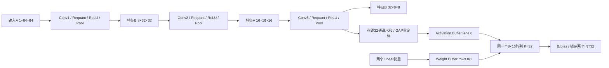

# 双任务整网 RTL：在线 GAP、共享阵列 Linear 与自动控制

当前整网入口为 `rtl/cnn_accelerator.v`，模型参数来自 `D:\Workspace\FPGA_CNN\artifacts_dual_task_baseline2_int8_qat\export`。输入一次 INT8 图片、发送一次 start，硬件自动运行三个卷积块、GAP 和两个 Linear，最终输出两个有符号 INT32。PS 只负责反量化、sigmoid 和应用决策。

## 数据流与控制



`cnn_network_controller.v` 执行：启动并清零 GAP → 从 Quant ROM 读取 GAP multiplier → 配置并启动 Conv1/2/3 → 等待最后一个 GAP 特征提交 → 加载两个 Linear → 写入32个 GAP 激活 → 启动阵列 Linear 模式 → 锁存两个结果并产生 done。

整网内部的层间特征通过真实 A/B RAM 传递。固定网络的所有基地址均为0，Conv1 A→B、Conv2 B→A、Conv3 A→B；独立单层引擎仍支持已有配置和非零基地址。

## 在线 GAP

`online_gap.v` 仅在 Conv3 执行期间监听实际 Post 写使能和写入数据。在同一个边沿，池化值写入 BRAM，同时计入相应通道的和。通道号为 `output_addr[10:6]`，因为每通道输出64个值，整网输出基址固定为0。

32个 INT32 通道累加器和32个6位计数器保存状态。第64次写入形成 `final_sum = old_sum + current_value`，然后将通道号和最终和送入重定标流水。输入来自 ReLU，范围0～127，因此求和和倍率乘积非负；半值远离零等价于对非负幅值加半后右移。

```
G[c] = saturate_INT8(round_away(sum[c] * 90035185 / 2^31))
```

multiplier 存在 Quant ROM 地址56，启动时读入；shift 固定31，并由导出脚本检查。没有再执行整数除64，没有额外 ReLU。GAP 特征先保存在32字节寄存器中，所有32个特征提交后 `gap_ready` 才有效。

求和与 Conv3 Post 完全重叠，没有独立 Feature RAM 读取。额外存储只保留通道和、计数及32维结果，没有新增整张特征图副本。重复通道完成后的写入、负值或越界写地址会产生 GAP 错误。

## Linear 参数与阵列复用

| 参数 | ROM 地址 | 数量 |
|---|---:|---:|
| Conv1/2/3 权重 | 0/72/1224 | 共5832个 INT8 |
| collision 权重 | 5832 | 32个 INT8 |
| steering 权重 | 5864 | 32个 INT8 |
| Conv bias | 0～55 | 56个 INT32 |
| collision bias | 56 | 847 |
| steering bias | 57 | -2602 |
| Conv multiplier | Quant 0～55 | 56个 INT32 |
| GAP multiplier | Quant 56 | 90035185 |

总权重5896字节、bias 58个、multiplier 57个，均在原 ROM 容量内。所有整数直接来自导出，不重新量化。

Conv3 完成且 GAP 全部提交后，Weight Loader 使用 Linear 模式加载两个32项权重向量及两个 bias。此时卷积阵列和 Activation Buffer 已经释放，控制器将32个 GAP 值写入 Activation Buffer bank0、lane0，按 `k=ic*9+tap` 映射到已有 tap bank。

Data Mapper 仍采用原有同步读取和错拍，只为激活列0、权重行0/1产生有效标记。其余 lane 即使留有旧数据，也不会产生有效乘累加。阵列仅 PE[0,0] 和 PE[1,0] 各执行32次 MAC，完成信号改为观察 PE[1,0] 的最后一次累加。卷积模式仍观察 PE[7,15]。

两个无 bias 点积直接取自同一个阵列的对应输出，随后分别加847和-2602。没有使用另一套专门的 FC 乘法器，也没有经过卷积 Post 的重定标/ReLU/池化。

## 顶层接口

`cnn_accelerator` 使用单一50 MHz时钟、高有效同步复位：

- 空闲时等待 `host_ready=1`，通过原同步 host 写接口把4096个输入 INT8 写入 A（`host_bank=0`、地址0～4095）。
- 给 `start` 一个周期脉冲；与 start 同拍的 host 请求不被接受。
- `busy` 覆盖整个网络，包括层间交接、GAP 等待、FC 参数加载和计算。busy 期间再次 start 及 host 读写均被忽略。
- 计算完成后，`collision_int32`、`steering_int32` 与 `result_valid=1` 同时有效，`done` 只脉冲一拍。`result_valid` 和数值保持，直到下一次接受 start 或复位；新 start 清除有效标志，旧数值不再代表当前任务。
- 完成后 host_ready 恢复，可回读 B 中的 Conv3 特征。新任务重新装载图片并 start；GAP 计数、和与提交掩码自动清零。
- 复位丢弃整个在途任务，清除结果有效和所有计算 token，但不清空 Feature RAM。
- GAP 或层错误触发一次受控 abort，复位内部计算模块、撤销结果有效，输出 done+error；接受新 start 时清除错误并可重试。

反量化仍在 PS：`steering_int32 × 4.8765890998470586e-05` 得到标签角度空间数值；`collision_int32 × 0.0001111633778391911` 得到 logit，再 sigmoid。

## 仿真验证

`tb_network` 使用全部30个导出样本：20个碰撞验证样本（10 safe、10 collision）和10个角度验证样本。每个样本只装载一次图片、发一次外部 start。三个卷积层、GAP、两个 Linear 都由 RTL 自动运行，没有软件 GAP/FC 或重装 golden 中间特征。

| 检查 | 总数 | 结果 |
|---|---:|---|
| 完整自动整网 | 30次 | PASS |
| 卷积 INT32，包含 bias | 1,720,320 | 逐项一致 |
| 池化 INT8 写入 | 430,080 | 逐项一致、唯一且完整 |
| 窗口元素 | 9,953,280 | 逐字节一致 |
| GAP 通道求和 INT32 | 960 | 逐项一致 |
| GAP 输出 INT8 | 960 | 逐项一致 |
| 两个 Linear 原始点积 | 60 | 逐项一致 |
| 最终两个 INT32 | 60 | 逐项一致 |
| Conv3 实际 BRAM 回读 | 61,440 | 逐字节一致 |

还核对每次 Linear 两个 PE 恰好各执行32次 MAC、其余126个 PE 的累加值为0，以及写 Activation Buffer 时卷积已不占用该 bank。中途复位分别发生在卷积读请求/返回、在线 GAP 和 FC 输入流水中，之后可正常重新执行。

独立测试：`tb_gap` 覆盖交错通道、连续通道完成、最后一个值、半值舍入、饱和、重复检测和复位；`tb_linear` 覆盖正负极值和混合有符号向量、无效 lane、K 映射与在途复位；`tb_control` 覆盖图顺序、等待 GAP、32次特征复制、busy start、结果保持、GAP/层错误 abort 和重启。

原 Array、Post 和 HNM 两样本六次单层回归均通过，单层计算周期没有变化。Golden 验证证明实现与模型整数参考数值一致，不意味着所有预测都与人工标签相同。

## 速度与资源

全部30个样本均为相同周期：

| 阶段 | 周期 | 50 MHz时间 |
|---|---:|---:|
| Conv1 | 11375 | 0.22750 ms |
| Conv2 | 19538 | 0.39076 ms |
| Conv3，在线 GAP 与其重叠 | 33860 | 0.67720 ms |
| FC 加载、复制与阵列计算阶段 | 333 | 6.66 μs |
| 网络启动、层交接和 GAP 尾部交接 | 10 | 0.20 μs |
| **整网** | **65116** | **1.30232 ms** |

相比原三层总计64773拍，只增加343拍，即6.86 μs、约0.53%。完整硬件推理吞吐约767.86次/秒；按 Conv/Linear 共2654272 MAC、每MAC两次操作计算为4.07622 GOPS，有效 PE MAC 利用率31.85%。GAP加法和重定标操作不计入该 MAC 吞吐口径。

以上时间不含主机图片上传、测试回读、PS反量化/sigmoid及系统外部调度，不是上板实测。

完整新顶层通过50 MHz布局布线：WNS +1.920 ns，WHS +0.050 ns；无建立/保持失败端点，无未约束内部端点。资源：20,017 LUT（37.63%）、18,191 FF（17.10%）、6.5 BRAM Tile（2 RAMB36＋9 RAMB18）、20 DSP（9.09%）。此为固定整网顶层和QAT参数的资源，不能把它与原通用层引擎的差额完全视为尾部模块独立资源。

仍有未分配板级引脚、未接PS7和DSP流水建议等DRC类别。已生成整网 DCP、网表及SDF，尚未执行此版本动态SDF回标；没有PS/AXI、板级bitstream或功耗实测。

## 工程与复现

Vivado 工程已设置综合顶层 `cnn_accelerator`、仿真顶层 `tb_network`，参数文件指向双任务QAT独立目录。原 `cnn_layer_accelerator` 默认 `ENABLE_NETWORK=0`，仍支持原单层接口；整网 wrapper 将其设为1。

```powershell
& 'D:\programm\anaconda\envs\vision_attention\python.exe' scripts/export_dual_qat_vectors.py
powershell -NoProfile -ExecutionPolicy Bypass -File scripts/run_sim.ps1 -Test network
powershell -NoProfile -ExecutionPolicy Bypass -File scripts/run_sim.ps1 -Test gap
powershell -NoProfile -ExecutionPolicy Bypass -File scripts/run_sim.ps1 -Test linear
powershell -NoProfile -ExecutionPolicy Bypass -File scripts/run_sim.ps1 -Test control
powershell -NoProfile -ExecutionPolicy Bypass -File scripts/run_sim.ps1 -Test array
powershell -NoProfile -ExecutionPolicy Bypass -File scripts/run_sim.ps1 -Test post
powershell -NoProfile -ExecutionPolicy Bypass -File scripts/run_sim.ps1 -Test layer
& 'D:\programm\anaconda\envs\vision_attention\python.exe' scripts/capture_network_inputs.py
& 'D:\Vivado\2023.2\bin\vivado.bat' -mode batch -source scripts/implement_full_network.tcl -log build/full_network/implementation.log -journal build/full_network/implementation.jou
& 'D:\Vivado\2023.2\bin\vivado.bat' -mode batch -source scripts/configure_project.tcl -log build/configure_full_network.log
& 'D:\programm\anaconda\envs\vision_attention\python.exe' scripts/verify_full_network.py
```

`capture_network_inputs.py` 在物理实现前保存源/参数哈希到 `build/full_network/implementation_inputs.json`。汇总脚本会拒绝使用已变化的输入来冒充原实现。

验证证据：`build/xsim_network.log`、各单元日志、`build/full_network/rtl_predictions.csv`、`build/full_network/verification_summary.json`。汇总包含模型来源、源码/参数/工具证据哈希，最终CSV的两个INT32来自RTL日志，Python仅进行反量化和sigmoid。
