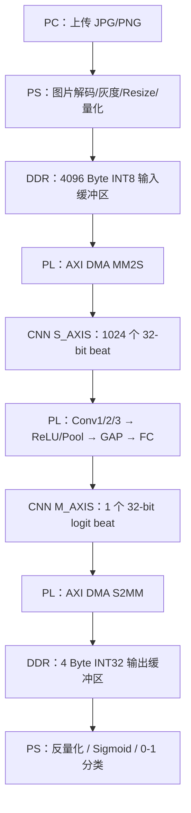
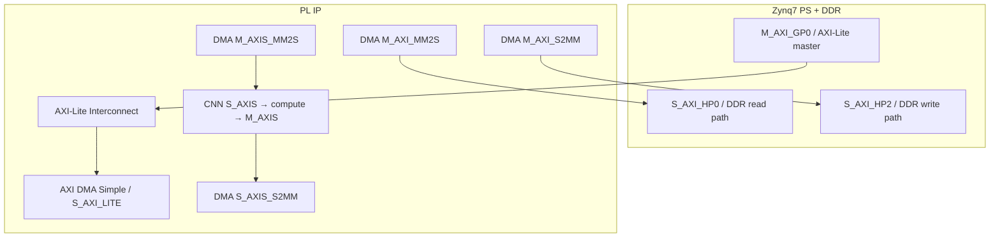

# PYNQ-Z2 PS–PL 协同 INT8 CNN 推理系统技术设计与接口规范（v2.0）

> **文档用途**：用于工程实现、算法模型导出、软件/RTL 数值对齐、PS–PL 联调和验收。所有必要事项直接写成**规格、输入、交付物和验收条件**，不采用人物对话或口头问答形式。
>
> **状态说明**：文中 `已定` 表示现有项目框图指定的目标；`推荐` 表示尚可调整的工程方案；`待确认（P0/P1）` 表示尚未获得可验证模型或运行环境证据，不允许在 RTL 中擅自假定；`已验收` 只有真实运行测试通过后才能标记。本文的代码是可复用参考，不代表已生成可直接上板运行的 CNN 比特流。

## AI 快速读取：固定接口与未决参数

```yaml
project:
  name: PYNQ-Z2 INT8 CNN collision-risk inference
  board: PYNQ-Z2
  soc: XC7Z020-1CLG400C
  deployment: PS(Python/Linux) + PL(RTL) + AXI DMA
  status: design_spec_not_yet_board_validated
network:
  task: binary_collision_risk_classification
  input: {shape: [1, 1, 64, 64], dtype: int8, size_bytes: 4096}
  proposed_input_range: [0, 127]  # 根据框图；需与导出软件逐元素对齐
  layers:
    - {name: conv1, kernel: [3, 3], stride: 1, padding: 1, channels: [1, 8]}
    - {name: relu1}
    - {name: maxpool1, kernel: [2, 2], stride: 2}
    - {name: conv2, kernel: [3, 3], stride: 1, padding: 1, channels: [8, 16]}
    - {name: relu2}
    - {name: maxpool2, kernel: [2, 2], stride: 2}
    - {name: conv3, kernel: [3, 3], stride: 1, padding: 1, channels: [16, 32]}
    - {name: relu3}
    - {name: maxpool3, kernel: [2, 2], stride: 2}
    - {name: gap, reduction: [8, 8]}
    - {name: fc, channels: [32, 1]}
  output: {shape: [1], dtype: int32, size_bytes: 4}
transport_recommendation:
  dma: simple_mode_bidirectional
  stream_width_bits: 32
  input_transfer: {bytes: 4096, beats: 1024}
  output_transfer: {bytes: 4, beats: 1}
  endianness: little_endian
  input_last: beat_1024
  output_last: beat_1
postprocess:
  threshold_probability: 0.5   # 待模型任务语义确认
  example_logit_scale: 0.0001237 # 仅来自现有示意图，非验证值
open_p0:
  - exact_preprocess_and_resize_semantics
  - quantization_algorithm_and_rounding
  - signed_weight_bias_and_layout_export
  - activation_weight_scale_and_zero_point_per_layer
  - integer_requantization_multiplier_shift_clamp
  - gap_and_fc_exact_integer_semantics
  - output_logit_scale_zero_point_and_class_definition
  - bit_exact_integer_reference_and_golden_vectors
  - model_version_and_training_framework
open_p1:
  - latency_fps_power_and_accuracy_targets
  - model_freeze_and_weight_reload_policy
  - vivado_pynq_versions_and_device_configuration
  - error_handling_and_continuous_frame_requirements
```

## 阅读导航（7 个核心板块）

1. **[板块 A：系统目标与总体架构](#板块-a系统目标与总体架构)**：范围、分工、网络、容量、计算量。
2. **[板块 B：模型计算与量化数值规范](#板块-b模型计算与量化数值规范)**：完整预处理、逐层整数语义、精确舍入、GAP/FC、输出定义。
3. **[板块 C：模型导出包与 Golden Data 交付规范](#板块-c模型导出包与-golden-data-交付规范)**：所有必需文件、格式、检查与软件金模型。
4. **[板块 D：PS 软件与 PS–PL 数据通信规范](#板块-dps-软件与-pspl-数据通信规范)**：输入数据、32-bit 打包、DMA 代码、结果后处理。
5. **[板块 E：Vivado 与 PL CNN 实现方案](#板块-evivado-与-pl-cnn-实现方案)**：所需 IP、连接、RTL 结构、内存规划和状态机。
6. **[板块 F：仿真、上板调试与验收标准](#板块-f仿真上板调试与验收标准)**：逐关卡验证、ILA、故障诊断、性能及准确率。
7. **[板块 G：版本管理、变更控制及工程交付](#板块-g版本管理变更控制及工程交付)**：未决项清单、目录、冻结规则、实施计划、参考资料。

---

# 板块 A：系统目标与总体架构

## A.1 目标与应用范围

目标平台为 PYNQ-Z2（Zynq-7020），构建以**单张道路图片为输入、碰撞风险二分类得分为输出**的 PS–PL 协同推理原型：

1. Windows/Linux 电脑经以太网访问 PYNQ-Z2 的 Jupyter，上传 JPG/PNG 图片。
2. PS 上的 Linux/Python 解码图片，进行灰度化、64×64 缩放、归一化、INT8 量化；结果为连续的 4096 字节数组。
3. PS 将 INT8 数组写入 DDR 中供 DMA 访问的缓存；PL 中的 AXI DMA MM2S 读取 DDR，形成 32-bit AXI4-Stream。
4. PL 中的 CNN 加速器完成三层卷积、ReLU、2×2 最大池化、GAP 和 FC，生成一个 INT32 logit。
5. CNN 经 AXI4-Stream → DMA S2MM 将 4 字节结果写回 DDR，PS 反量化、执行 Sigmoid 与类别阈值判断并显示结果。

**首版边界**：离线单帧输入、手动发起推理、固定模型权重、单时钟域、逐层可验证。首版不包含 HDMI 实时接入、在线训练、多图并发、动态神经网络结构或车辆控制。碰撞风险概率和阈值的应用有效性需要独立数据集验证，本设计不构成实车安全保证。

## A.2 系统数据流与 PS/PL 边界



| 功能 | 推荐执行位置 | 数据及约束 |
|---|---|---|
| 图片接收、读取、解码 | PS | JPG/PNG，不由 FPGA 负责压缩格式解码 |
| 灰度、尺寸变换、输入量化 | PS | 与软件金模型逐位一致 |
| 图像数据搬运、输出回传 | AXI DMA | MM2S/S2MM，Simple 模式 |
| 卷积、重定标、ReLU、MaxPool、GAP、FC | PL | INT8 乘法、INT32 累加、规定的整数舍入 |
| 反量化、Sigmoid、风险阈值 | PS | 使用实际导出的最终输出 scale/zero_point |
| CNN 内部特征图 | PL BRAM/逻辑 | 首版不通过 PS 往返传输 |

## A.3 CNN 网络拓扑：目前的目标定义

```mermaid
flowchart LR
  IN["1×64×64 INT8"] --> C1["Conv1 3×3 s1 p1: 1→8"]
  C1 --> R1["ReLU1"] --> P1["MaxPool1 2×2 s2"]
  P1 --> C2["Conv2 3×3 s1 p1: 8→16"]
  C2 --> R2["ReLU2"] --> P2["MaxPool2 2×2 s2"]
  P2 --> C3["Conv3 3×3 s1 p1: 16→32"]
  C3 --> R3["ReLU3"] --> P3["MaxPool3 2×2 s2"]
  P3 --> GAP["GAP 32×8×8→32"] --> FC["FC 32→1"] --> OUT["INT32 logit"]
```



| 网络阶段 | 输出逻辑形状（C×H×W） | 阶段输出 dtype | 输出数据量（Byte） | MAC 次数 |
|---|---|---|---:|---:|
| Input | 1×64×64 | INT8 | 4,096 | 0 |
| Conv1 + ReLU1 | 8×64×64 | INT8 | 32,768 | 294,912 |
| MaxPool1 | 8×32×32 | INT8 | 8,192 | 0 |
| Conv2 + ReLU2 | 16×32×32 | INT8 | 16,384 | 1,179,648 |
| MaxPool2 | 16×16×16 | INT8 | 4,096 | 0 |
| Conv3 + ReLU3 | 32×16×16 | INT8 | 8,192 | 1,179,648 |
| MaxPool3 | 32×8×8 | INT8 | 2,048 | 0 |
| GAP + requant | 32 | INT8 | 32 | 求和及缩放，另计 |
| FC | 1 | INT32 | 4 | 32 |
| **合计** | — | — | — | **2,654,240 MAC** |

MAC 只统计卷积与 FC 的乘加，不包含偏置、池化比较、ReLU、GAP 求和和重定标。中间层的 INT8 输出格式、算子融合位置属于**目标约定**，正式实现须由部署量化模型确认。

## A.4 模型参数规模与板级约束

| 层 | Weight shape（建议采用 OIHW） | INT8 权重 | INT32 Bias 个数 |
|---|---|---:|---:|
| Conv1 | `[8,1,3,3]` | 72 B | 8 |
| Conv2 | `[16,8,3,3]` | 1,152 B | 16 |
| Conv3 | `[32,16,3,3]` | 4,608 B | 32 |
| FC | `[1,32]` | 32 B | 1 |
| **合计** | — | **5,864 B** | **57（228 B）** |

PYNQ-Z2 使用 Zynq XC7Z020-1CLG400C，具备 512 MB DDR3、220 个 DSP48，以及器件标称约 630 KiB PL Block RAM（具体资源统计和板卡版本以器件数据手册、Vivado 为准）。资源是否充足需要结合 buffer 映射、PE 并行度和实际实现报告判断，不能把理论标称资源视为可直接全部分配给 CNN。

## A.5 当前已定 / 推荐 / 待确认边界

| 状态 | 内容 |
|---|---|
| **已定：现有设计目标** | 单通道 64×64；3 层 3×3 卷积 1→8→16→32；3 次 ReLU 和 2×2 池化；GAP；FC32→1；PS/PL 输出为单个 INT32 logit |
| **推荐，待工程确认** | 单个双向 AXI DMA、Simple 模式、32-bit AXI 流、PS GP0 + HP0/HP2、100 MHz 单时钟、静态 BRAM/ROM 权重、自动触发 CNN |
| **P0：未定但数值必需** | 准确的模型版本；预处理代码；输入/内部量化 scale 与 zero_point；权重、偏置及布局；重定标整数算法；GAP/FC 计算顺序；最终 logit 元数据；软件金模型与测试样本 |
| **P1：工程需求待定** | 运行镜像与 Vivado 版本、速度/功耗/精度指标、模型冻结时间、硬件异常恢复、动态权重更新需求 |

---

# 板块 B：模型计算与量化数值规范

## B.1 图像预处理：必须提供可复现的精确定义（P0）

**基准处理链（按当前框图）**：`读取原图 → 灰度化 → 双线性缩放至 64×64 → 归一化 pixel/255 → q=round(x×127) → 有符号 INT8 → 按行展开`。

下表中的“待确认”并不改变现有目标，而是要求明确**实际数值实现**：

| 字段 | 现有方案 | 需要固化的精确规则 |
|---|---|---|
| 原始输入格式 | JPG/PNG | 解码库及版本、输入色彩空间、EXIF 方向处理、异常图片行为 |
| 颜色到灰度 | 单通道 | OpenCV BGR→GRAY、PIL 转 L 或其他公式；整数舍入语义 |
| 尺寸变换 | 64×64 | 双线性插值的具体实现（如 `cv2.INTER_LINEAR`）、坐标系、antialias 选项 |
| 宽高比 | 直接 Resize（暂定） | 是否先裁剪、等比缩放或 padding，padding 值为何 |
| 操作顺序 | 先灰度再缩放 | 顺序不能改变；确认先除 255 还是先缩放/取整 |
| 归一化 | `gray/255` | 是否还有均值、标准差、gamma 或动态范围变换 |
| 输入量化 | `round(x*127)` | 精确 scale/zero_point、舍入方式、整数饱和范围 |
| 张量布局 | NCHW / 单通道 CHW | 批次 `N=1`，扁平化为行优先 `row*64+col` |
| 数据类型 | `int8` | 原始字节补码的解释、是否存在负数输入 |

**不能用“Resize 64×64”作为唯一验收条件。** 不同软件库的双线性插值及边界处理可能导致 1 LSB 的差异，进入 CNN 后会累积为较大的整数输出差异。

### B.1.1 参考输入量化公式

设像素灰度为整数 `g∈[0,255]`，当前框图要求：

\[
x=\frac{g}{255},\qquad q=\operatorname{clip}_{[0,127]}\bigl(\operatorname{round}(127x)\bigr)
\]

对应输入 tensor 的逻辑形状 `[1,1,64,64]`（单张处理时 `[64,64]`），逐行排列 4096 个 `int8` 元素。示例：灰度 `200` → `round(200*127/255)` = `100`，而不是将 `200` 的 bit pattern 解释为有符号 int8 的 `-56`。

**关于整数 rounding**：NumPy `np.rint` 按“就近、遇 0.5 取偶数”；很多模型推理后端/硬件采用别的 rounding 规则。任何一个字节不同都应该记录差异原因，不能默认容忍。

## B.2 必须冻结的网络数学定义（P0）

| 层/参数 | 已知结构 | 必须确认的数值细节 |
|---|---|---|
| Conv1/2/3 | 3×3、stride=1、padding=1 | 交叉相关还是数学卷积（卷积核是否翻转）；padding 数值；边界与通道顺序；是否分组/膨胀；Bias 位置 |
| ReLU1/2/3 | 3 次 | 在 INT32 域还是 requant 之后；量化零点对应的阈值；是否与 Conv 融合 |
| MaxPool1/2/3 | 2×2、stride=2 | 量化尺度是否跨池化保持不变；边界规则；通道顺序 |
| GAP | 32 通道、每通道 8×8 | 求和/除以 64 顺序、重定标系数、负数舍入、输出 INT8 规则 |
| FC | 32→1 | 权重展开顺序、Bias、是否直接输出原始 INT32 ACC；是否还有 requant |
| 最终输出 | 1 个 logit | scale、zero_point、类别含义、阈值以及 score 是否校准 |

### B.2.1 有符号 INT8 卷积 / Bias

一般量化卷积可表述为：

\[
acc_{o,h,w}=\sum_{i,r,c}(q_x-z_x)(q_w-z_w)+b_{o,\mathrm{int}}
\]

`qx`、`qw` 分别是整数激活与整数权重；`zx`、`zw` 是零点。如果确认是对称量化（`zx=zw=0`），上式可简化为普通 `INT8×INT8 → INT32 accumulate`。**不得在未检查导出元数据前假定所有 zero point 均为 0。**

Bias 必须明确是导出的 `int32` 值还是需要重算的浮点值。典型要求是 bias 的实数尺度等于 `s_x * s_w[o]`（逐通道量化时随输出通道变化），但应以具体量化后端为准。

卷积边缘的 padding 应填入代表实数 0 的量化值：如果激活零点是 `z_x`，padding 需按模型的量化约定处理，不能无条件把整数 0 填入边界。

### B.2.2 重定标与饱和

每层的 INT32 输出需转换为后续 INT8 激活。常见参考形式：

\[
q_{out}=\operatorname{clip}_{[-128,127]}\left(\operatorname{round}\left(\frac{acc\cdot M_o}{2^{S_o}}\right)+z_{out}\right)
\]

其中 `M_o`、`S_o` 可以逐输出通道变化，且**仅为示例写法**；需要提供最终硬件采用的整数乘数、移位位宽、舍入与负数处理、结果溢出及饱和规则。硬件对负值右移、乘法中间位宽、加零点顺序必须与软件金模型一致。

| 量化元数据 | 必需精度与单位 |
|---|---|
| activation scale / zero_point | 每个输入/输出特征张量的浮点值和整数零点 |
| weight scale / zero_point | 每层 per-tensor 或 per-output-channel，标注 channel axis |
| Bias | 每输出通道 int32，记录存储位宽与所属量化尺度 |
| requant multiplier / shift | 每输出通道或每层，包含定点位宽、左/右移、乘法舍入、饱和规则 |
| 计算阶段 | Bias、ReLU、requant、pool 的固定顺序，不可自由交换 |
| overflow/rounding | INT32 中间溢出是否允许；负值右移及 ties 规则 |

### B.2.3 ReLU 与 MaxPool

ReLU 是实数 `max(x,0)`。对于量化输出 `q`，若零点为 `z`，ReLU 的量化域阈值应与 `z` 对齐，不能普遍写成 `max(q,0)`。池化是同尺度数据的最大值比较，可以直接在同样的量化表示上执行，但必须确认池化前后是否发生额外的 requant。

### B.2.4 GAP 必须明确的整数平均语义

Pool3 输出为 `[32,8,8]`，第 `c` 通道：

\[
\mathrm{mean}_c=\frac{1}{64}\sum_{h=0}^{7}\sum_{w=0}^{7}x_{c,h,w}
\]

当前框图的 `GAP(sum 64) + Re-scale → 32 INT8` 不能据此断定代码必须先右移 6 位。需明确：

- 是先对 INT8 求和后除以 64，再 requant，还是将 `1/64` 合入单次固定点重定标；不可重复除以 64。
- 求和是否对 `(q_x-z_x)` 进行；GAP 中间累加器位宽及符号；负数平均时如何舍入。
- GAP 输出 scale、zero_point、INT8 饱和范围、32 个通道顺序；软件精确参考结果。

64 个 int8 的求和在数学上落入 `[-8192,8128]`，至少需足够的有符号位宽；推荐用 INT32 累加以统一实现和调试。

### B.2.5 FC 及最终 INT32 的数值含义

根据现有框图，FC 使用 `INT8×INT8 + INT32 bias`，输出 1 个 `INT32 logit`。必须明确输出是：

1. 直接的有符号整数累加值（通常包含 Bias）；或
2. 经附加整数重定标后的 INT32；或
3. 其他打包或量化形式。

这三种格式不能混用。输出格式一经确认，AXI DMA 保持固定为 4 字节，PS 才能正确解释该值。

## B.3 最终风险分数、分类语义及阈值（P0）

若最终输出采用仿射量化：

\[
logit_{real}=(q_{logit}-z_{logit})s_{logit},\qquad
p=\frac{1}{1+e^{-logit_{real}}}
\]

图中给出的 `s_logit=0.0001237` 暂作为**待核实示例值**，不能在正式部署代码中不经验证地写死。需要记录：

- `s_logit` 的模型导出来源；是否为正；是否存在 `z_logit`。
- 分类标签 `0/1` 的含义（例如 `1=存在碰撞风险`）；数据集中正样本定义。
- 分类阈值是 `p>=0.5` 还是经验证集优化后的其他阈值；比较运算等于阈值时归属哪个类别。
- 准确率、召回率、误报率、漏报率、混淆矩阵；预测概率是否经过校准。

仅在 `s_logit > 0` 且 `p_threshold=0.5` 时，可用 `q_logit >= z_logit` 进行等价阈值判断；当 `z_logit=0` 才可进一步简化为 `q_logit>=0`。如果阈值不同于 0.5，必须先变换到相同数值域，不得直接比零。

## B.4 量化模型来源和冻结条件（P0）

必须记录以下信息，才能声称当前 RTL 与某个量化模型一致：

| 条目 | 强制记录 |
|---|---|
| 训练/推理框架 | PyTorch / ONNX Runtime / TensorFlow 等及精确版本 |
| 原始浮点模型 | 网络配置、权重文件、SHA-256 校验值、数据集版本 |
| 量化方式 | PTQ / QAT、静态/动态、逐张量/逐通道、对称/非对称 |
| 量化后模型 | 唯一 `model_id`、版本、量化文件、SHA-256 |
| 量化后端 | 实际产生整数行为的 kernel/运行时、算子融合和舍入语义 |
| 导出工具 | 导出脚本 commit / 版本、导出时间、元数据 schema_version |
| 对照程序 | 可以重跑的整数金模型及环境依赖锁定文件 |

模型输入和输出形状即使不变，只要权重、量化参数或算子融合改变，也属于**新模型版本**，必须重新执行逐层数值回归和端到端验收。

---
# 板块 C：模型导出包与 Golden Data 交付规范

## C.1 交付物总表（P0：实现完整 CNN 前必须具备）

交付内容应当是**可以重复生成、可由机器检查的整数模型部署包**，而不是仅有一个 `.pth` 模型文件或网络结构图片。

| 交付项 | 必需内容 | 验收依据 |
|---|---|---|
| `model_spec.json` | 输入输出、逐层算子、张量形状、通道顺序、padding、Bias、ReLU/GAP/FC 的语义 | 与网络表及参考执行图完全一致 |
| `preprocess.py` | 从原始图片到 4096 字节 INT8 的确定性代码 | 固定原图的输出逐字节相同 |
| `quant_params.json` | 所有激活/权重 scale、zero_point、量化轴、重定标参数、rounding、saturation | schema 完整，不出现隐式默认参数 |
| `weights/*.bin` 或 `*.npy` | Conv1/2/3/FC 全部有符号 INT8 权重 | 形状、个数、哈希和存储顺序正确 |
| `biases/*.bin` 或 `*.npy` | Conv1/2/3/FC 的全部 INT32 偏置 | 8、16、32、1 个值，scale 定义已知 |
| `reference_integer.py` | 可复现的位精确整数推理；支持逐层导出 | 与导出模型一致、可自动测试 |
| `golden_data/` | 固定输入、各层 INT32/INT8 输出、最终 logit、浮点输出和标签 | 逐元素匹配或按明确、可解释的规则比较 |
| `evaluation.json` | 数据集划分、量化前后评价指标、阈值与标签含义 | 与模型版本绑定并可复测 |
| `manifest.json` | 版本、运行时、导出脚本、SHA-256、文件类型和 shape | 能检测错版本或文件被替换 |

仅有 ONNX 文件也不一定足够：其中可能包含融合算子、框架定义的 requant、隐式 zero-point 或无法直接观察的累加器数值。需要进一步导出**供 RTL 使用的整数参数及金模型**。

## C.2 推荐的部署包目录

```text
model_export_v1/
├── manifest.json
├── model_spec.json
├── quant_params.json
├── preprocess.py
├── export_model.py
├── reference_integer.py
├── requirements.lock.txt
├── model_float.onnx                   # 如果可提供，便于核查
├── model_quantized.onnx               # 或实际部署格式
├── weights/
│   ├── conv1_weight_int8.npy
│   ├── conv2_weight_int8.npy
│   ├── conv3_weight_int8.npy
│   └── fc_weight_int8.npy
├── biases/
│   ├── conv1_bias_int32.npy
│   ├── conv2_bias_int32.npy
│   ├── conv3_bias_int32.npy
│   └── fc_bias_int32.npy
├── generated_rtl_memory/
│   ├── conv1_weight.mem
│   ├── conv2_weight.mem
│   ├── conv3_weight.mem
│   ├── fc_weight.mem
│   └── README_format.md
├── golden_data/
│   ├── cases.json
│   ├── zero_image/
│   ├── all_127/
│   ├── gradient/
│   ├── impulse/
│   ├── checkerboard/
│   ├── road_low_risk_001/
│   └── road_high_risk_001/
└── evaluation.json
```

`.npy` 用于保留张量形状与 dtype；`.bin` 和 `.mem` 用于硬件数据加载和 `$readmemh` 仿真。若直接从 `.npy` 生成 FPGA ROM 文件，导出脚本必须记录元素的扫描次序和 `int8` 负数的补码表示。

## C.3 参数文件的约束与结构示例

以下 **JSON 为结构模板，不包含任何真实量化值**。`null` 表示必须从真实模型导出，禁止拿模板原样生成 RTL：

```json
{
  "schema_version": "1.0",
  "model_id": "REPLACE_WITH_FROZEN_MODEL_ID",
  "tensor_layout": "NCHW",
  "input": {
    "name": "input",
    "shape": [1, 1, 64, 64],
    "dtype": "int8",
    "scale": null,
    "zero_point": null,
    "rounding": null,
    "clamp": [0, 127]
  },
  "conv1": {
    "weight_shape": [8, 1, 3, 3],
    "weight_layout": "OIHW",
    "weight_dtype": "int8",
    "weight_scale": null,
    "weight_zero_point": null,
    "weight_quant_axis": null,
    "bias_dtype": "int32",
    "bias_scale_rule": null,
    "accumulator_dtype": "int32",
    "output_scale": null,
    "output_zero_point": null,
    "requant_multiplier": null,
    "requant_shift": null,
    "requant_rounding": null,
    "requant_saturation": null,
    "relu_execution_order": null
  },
  "conv2": {"parameter_source": "MUST_EXPORT_SEPARATELY"},
  "conv3": {"parameter_source": "MUST_EXPORT_SEPARATELY"},
  "gap": {
    "sum_dtype": "int32",
    "mean_divisor": 64,
    "division_requant_order": null,
    "rounding": null,
    "output_scale": null,
    "output_zero_point": null
  },
  "fc": {
    "weight_shape": [1, 32],
    "weight_layout": null,
    "bias_dtype": "int32",
    "output_is_raw_accumulator": null,
    "output_scale": null,
    "output_zero_point": null
  },
  "postprocess": {
    "positive_class_label": null,
    "sigmoid": true,
    "probability_threshold": null,
    "probability_calibrated": null
  }
}
```

**生成器检查规则**：`null` 或 `MUST_EXPORT_SEPARATELY` 出现在 P0 字段时，打包工具应直接停止，不允许静默采用 scale=1、zero_point=0、舍入四舍五入等猜测值。实际格式可以另定，但必须覆盖上述语义。

## C.4 权重、偏置与存储顺序

| Tensor | 强制逻辑形状 | 建议布局 | 说明 |
|---|---|---|---|
| Conv1 weights | `[8,1,3,3]` | OIHW | 输出通道最快/最慢变化由显式地址规则控制；默认存为 C-order |
| Conv2 weights | `[16,8,3,3]` | OIHW | 不能混淆 OIHW 与 HWIO |
| Conv3 weights | `[32,16,3,3]` | OIHW | 核内行、列方向与卷积实现一致 |
| FC weights | `[1,32]` | `[out,in]` | 与 GAP 32 通道顺序一致 |
| Conv/FC biases | `[8]`、`[16]`、`[32]`、`[1]` | C-order | int32 小端存储（如 `.bin`） |

示例 OIHW 线性权重地址（仅在确定采用该布局时有效）：

\[
addr=(((o\cdot C_{in}+i)\cdot K_h+r)\cdot K_w+c)
\]

导出端必须记录 dtype、元素个数、存储 endianness、符号解释、哈希；RTL ROM 地址生成器必须使用相同公式。`int8=-1` 以 `0xFF` 保存，后续乘法必须按有符号数解释。

## C.5 Golden Data 需要保存的每一层

| 阶段 | 推荐文件名 | 形状 | dtype | 作用 |
|---|---|---|---|---|
| 原始图片 | `original.jpg` | 原始尺寸 | 图像文件 | 端到端可复现 |
| 输入预处理 | `input_int8.npy` | `[1,64,64]` | INT8 | 测 PS 预处理和输入加载 |
| Conv1 累加 | `conv1_acc_int32.npy` | `[8,64,64]` | INT32 | 测权重、Bias、padding |
| Conv1 requant | `conv1_requant_int8.npy` | `[8,64,64]` | INT8 | 测重定标 |
| ReLU1 | `relu1_int8.npy` | `[8,64,64]` | INT8 | 测激活阈值 |
| Pool1 | `pool1_int8.npy` | `[8,32,32]` | INT8 | 测池化 |
| Conv2 累加/重标定 | `conv2_acc_int32.npy` / `conv2_requant_int8.npy` | `[16,32,32]` | INT32 / INT8 | 定位第二层误差 |
| ReLU2 / Pool2 | `relu2_int8.npy` / `pool2_int8.npy` | `[16,32,32]` / `[16,16,16]` | INT8 | 验证顺序 |
| Conv3 累加/重标定 | `conv3_acc_int32.npy` / `conv3_requant_int8.npy` | `[32,16,16]` | INT32 / INT8 | 定位第三层误差 |
| ReLU3 / Pool3 | `relu3_int8.npy` / `pool3_int8.npy` | `[32,16,16]` / `[32,8,8]` | INT8 | 验证池化及内存布局 |
| GAP 求和 | `gap_sum_int32.npy` | `[32]` | INT32 | 验证每通道 64 点归约 |
| GAP requant | `gap_out_int8.npy` | `[32]` | INT8 | 验证除法、舍入、scale |
| FC logit | `fc_logit_int32.npy` | `[1]` | INT32 | 最终 PL 验收依据 |
| 输出解释 | `result.json` | 标量 | JSON | scale、zero_point、实数 logit、Sigmoid、类别 |

如果实际整数模型在某些节点实施融合，导致中间张量不直接可见，应通过**位精确参考实现**计算这些节点；不能简单用浮点网络的某层激活当作 INT8 金标准。

每个 `.npy` 的文件 manifest 应包含 shape、dtype、tensor layout 和 SHA-256。对于输出 INT32，验收以**原始整数完全相等**为主，最终分类相同不足以证明计算正确。

## C.6 Golden Data 测试集合

至少准备以下测试向量；真实道路图应分别覆盖高/低风险样本以及不同亮度、纹理、宽高比：

| 输入类别 | 要求 | 目的 |
|---|---|---|
| 全零 | 全像素 0 | Bias、padding、复位 |
| 全 127 | 全像素 127 | 极值、乘加位宽、饱和 |
| 行列梯度 | 每行/列值变化，固定生成规则 | 拆包顺序、通道/行列映射 |
| 单点脉冲 | 固定坐标为高值，其余 0 | 3×3 核方向、边界 |
| 棋盘格 | 周期变化 | 空间邻域与池化 |
| 负数特征测试 | 在中间层直接注入负 INT8 张量 | 符号扩展、ReLU、rounding |
| 真实道路 | 至少 20 张固定样本，涵盖 0/1 类 | 端到端语义和模型一致性 |

要区分**模型输入不含负数**和**中间量化特征可能为负数**。仅用输入全零/127 测试不足以覆盖负值右移、溢出和符号位错误。

## C.7 可执行验收：模型部署包必须满足

1. 输入图 `original.jpg` 经 `preprocess.py` 得到的 `input_int8.npy` 与 PS 部署程序结果 **4096 字节一致**。
2. 权重数组元素总量为 5,864，偏置数组为 57 个 int32；文件布局与 `model_spec.json` 完全一致。
3. `quant_params.json` 对所有 Conv/GAP/FC 以及每次 ReLU/Pool 所需的 scale/zero-point 和 rounding 均有明确解释。
4. `reference_integer.py` 能在固定环境复现所有已交付 Golden Data，测试脚本退出状态可自动判 PASS/FAIL。
5. `manifest.json` 唯一关联模型版本、量化参数、权重、Golden 和评估指标；任何文件改变均能通过哈希检查发现。
6. 模型软件验证应分别报告浮点模型、量化模型在同一固定测试集上的指标；精度偏差不能由 PS/PL 通信调试来掩盖。

---

# 板块 D：PS 软件与 PS–PL 数据通信规范

## D.1 PS 侧软件工作流与操作环境

PC 与 PYNQ-Z2 的通信使用以太网，电脑浏览器只提供控制界面；Jupyter Notebook 中的 Python 实际运行在 PYNQ-Z2 的 ARM PS 上。首版主要文件：

```text
ps/
  preprocess.py             # 读取 JPG、生成 64×64 INT8
  dma_loopback.ipynb        # AXI FIFO 回环
  dma_sum.ipynb             # 模拟 CNN：4096B 输入、4B 输出
  cnn_inference.ipynb       # 真正 CNN + logit 后处理
images/
  test.jpg
  cnn_input_int8.bin
  cnn_input_int8.mem
```

若电脑网线直连板卡，常见静态地址为 PC `192.168.2.1/24`、PYNQ-Z2 `192.168.2.99/24`；Jupyter 端口与镜像版本相关，不强制假定为 `9090`。先验证启动模式为 SD、板卡 IP、`ping` 和板载 Jupyter。部署过程中不应无约束升级 PYNQ 自带的 Python 依赖。

## D.2 PS 图像预处理参考实现

**以下按当前框图定义实现**。该实现仅作为接口起点；当真实模型的 `preprocess.py` 与此处有差异时，以冻结模型的正式规则为准，并同步更新这段代码。

```python
from pathlib import Path
import cv2
import numpy as np

source = Path('test.jpg')
img_bgr = cv2.imread(str(source), cv2.IMREAD_COLOR)
if img_bgr is None:
    raise FileNotFoundError(f'图片读取失败: {source.resolve()}')

gray = cv2.cvtColor(img_bgr, cv2.COLOR_BGR2GRAY)
gray64 = cv2.resize(gray, (64, 64), interpolation=cv2.INTER_LINEAR)
x = gray64.astype(np.float32) / 255.0
q = np.clip(np.rint(x * 127.0), 0, 127).astype(np.int8)
q = np.ascontiguousarray(q)
assert q.shape == (64, 64) and q.dtype == np.int8 and q.nbytes == 4096

q.tofile('cnn_input_int8.bin')
with open('cnn_input_int8.mem', 'w', encoding='utf-8') as f:
    for value in q.ravel(order='C'):
        f.write(f'{int(value) & 0xff:02X}\n')

print('shape/dtype/bytes:', q.shape, q.dtype, q.nbytes)
print('value range:', int(q.min()), int(q.max()))
```

**文件含义**：`.bin` 为无头 4096 字节；`.mem` 为 4096 行两位十六进制数据，可在 Verilog `$readmemh` 中读取。它们不是 PNG/JPG 编码格式。输入索引 `index=row*64+col`，第一个像素 `(0,0)`，最后一个 `(63,63)`。

## D.3 AXI 接口及传输规模

| 通路 | 接口 | 每次推理的数据 | 谁控制 |
|---|---|---|---|
| PS 控 DMA | PS `M_AXI_GP0` → DMA `S_AXI_LITE` | 控制寄存器与缓冲区地址 | Python/PYNQ 驱动 |
| DDR → CNN | DMA MM2S（AXI MM + AXI4-Stream） | 4096 字节、1024 个 32-bit beat | DMA |
| CNN → DDR | CNN M_AXIS → DMA S2MM（AXI4-Stream + AXI MM） | 4 字节、1 个 32-bit beat | CNN + DMA |
| 可选 CNN 控制 | PS GP0 → CNN AXI4-Lite | 启动/错误/状态/参数寄存器 | 首版可省略 |

输入图像不经由 GP0 寄存器逐像素搬运，GP0 用来控制 DMA；DMA 使用 PS 的 HP 接口访问 DDR。并非必须为 MM2S/S2MM 设置不同 HP 口，但首版推荐分别使用 HP0 与 HP2，便于调试和分离读写通路。

## D.4 32-bit AXI4-Stream 字节契约（固定）

```text
输入 image[0..4095]：4096 个 int8 字节，按行优先排列

第 k 次有效握手（k = 0..1023）：
  TDATA[ 7: 0] = image[4*k+0] 的原始 8 bit
  TDATA[15: 8] = image[4*k+1] 的原始 8 bit
  TDATA[23:16] = image[4*k+2] 的原始 8 bit
  TDATA[31:24] = image[4*k+3] 的原始 8 bit
  TKEEP        = 4'b1111
  TLAST        = (k == 1023)

输出：
  TDATA = 1 个 int32 logit 的 32-bit 补码
  TKEEP = 4'b1111
  TLAST = 1（唯一输出 beat）
  全部字节小端（little endian），整个输出长度 4 字节

AXIS 仅在 TVALID && TREADY 的时钟沿完成 1 次传输。
```

`TVALID=1`、`TREADY=0` 时发送端必须保持 `TVALID/TDATA/TKEEP/TLAST` 稳定；输入端只在握手后增加字计数。对于输入第 1024 次握手（从 0 开始索引 1023）应断言 `TLAST=1`。对于输出唯一一次握手同时断言 `TLAST=1`，否则 S2MM 可能一直等待包结束。

**实际打包实现**：PYNQ-Z2 的 ARM Linux 通常采用小端序，使用 `pixels.view('<u4')` 将 4096 个 8-bit 字节无复制地解释为 1024 个 32-bit 无符号字；位级字节顺序仍由上面契约定义。`int8` 为负值时要传输的是原始二补码位模式，绝不能逐字节按 Python 负整数加减处理。

## D.5 第一次：DMA + AXI4-Stream FIFO 原样回环

在 Vivado 中先把 `DMA M_AXIS_MM2S → AXIS FIFO → DMA S_AXIS_S2MM` 连通。FIFO 必须正确传递 `TLAST/TKEEP`。以下程序**只能在已生成并加载对应回环 bit/hwh 时使用**：

```python
from pynq import Overlay, allocate
import numpy as np

ol = Overlay('dma_test.bit')
print(ol.ip_dict.keys())
dma = ol.axi_dma_0

tx = allocate(shape=(1024,), dtype=np.uint32)
rx = allocate(shape=(1024,), dtype=np.uint32)
try:
    tx[:] = np.arange(1024, dtype=np.uint32)
    rx[:] = 0
    tx.flush()
    dma.recvchannel.transfer(rx)
    dma.sendchannel.transfer(tx)
    dma.sendchannel.wait()
    dma.recvchannel.wait()
    rx.invalidate()
    assert np.array_equal(tx, rx), '4096字节回环数据不匹配'
    print('DMA FIFO loopback PASS')
finally:
    tx.freebuffer()
    rx.freebuffer()
```

回环通过后，在相同硬件中改用真实的 `cnn_input_int8.bin`：

```python
pixels = np.fromfile('cnn_input_int8.bin', dtype=np.int8)
assert pixels.shape == (4096,)
packed = pixels.view('<u4')
assert packed.shape == (1024,)
# tx[:] = packed；接收 rx 依旧为 1024 个 uint32
# 回环完成后：assert np.array_equal(rx.view(np.int8), pixels)
```

## D.6 第二次：模拟 CNN 输入 4096B、输出 4B

使用一个简单的 AXI4-Stream 求和模块替代 FIFO：接收 1024 个 32-bit 字，每个字拆出 4 个 `signed int8`，求 4096 个数的和，输出一个 `signed int32`，并在此唯一输出 beat 上断言 `TLAST=1`。

```python
pixels = np.fromfile('cnn_input_int8.bin', dtype=np.int8)
expected = int(pixels.astype(np.int64).sum())
print('预期整数求和:', expected)
```

**验收**：输入 1024 次有效握手，输出 1 次有效握手；PS 端读回 `int32` 与上述 `expected` 完全一致；连续多次不死锁。该阶段排除“DMA 能回环但返回长度 4B 时接收端卡死”的风险。

## D.7 第三次：真实 CNN 整网推理

前提：已生成 `cnn.bit`/`cnn.hwh`；Overlay 中 DMA 实例名是 `axi_dma_0`；CNN 收齐输入便自动运行；输出仅一个 int32，S2MM 端有效 `TLAST=1`。

```python
import math
import numpy as np
from pynq import Overlay, allocate

ol = Overlay('cnn.bit')
dma = ol.axi_dma_0
pixels = np.fromfile('cnn_input_int8.bin', dtype=np.int8)
assert pixels.size == 4096
packed = pixels.view('<u4')

tx = allocate(shape=(1024,), dtype=np.uint32)
rx = allocate(shape=(1,), dtype=np.int32)
try:
    tx[:] = packed
    rx[:] = 0
    tx.flush()
    dma.recvchannel.transfer(rx)  # 先启动接收，避免背压
    dma.sendchannel.transfer(tx)
    dma.sendchannel.wait()
    dma.recvchannel.wait()
    rx.invalidate()
    logit_int32 = int(rx[0])
finally:
    tx.freebuffer()
    rx.freebuffer()

# 实际工程从 model_export/quant_params.json 读取以下参数。
# 下面 scale 仅为原框图示例值，尚未验证。
logit_scale = 0.0001237
logit_zero_point = 0     # 示例占位，不得未经模型确认而固定
logit_real = (logit_int32 - logit_zero_point) * logit_scale

if logit_real >= 0:
    probability = 1.0 / (1.0 + math.exp(-logit_real))
else:
    ex = math.exp(logit_real)
    probability = ex / (1.0 + ex)
label = int(probability >= 0.5)  # 必须核实标签语义和阈值
print(logit_int32, logit_real, probability, label)
```

若实际 CNN IP 还需要 AXI4-Lite 启动寄存器，必须在上述通信代码中增加明确的准备、启动和完成顺序。`wait()` 是阻塞等待；硬件缺少输出握手或 TLAST 时可能一直等待，不代表 Python 推理速度慢。

## D.8 PS 软件基本异常处理

| 异常 | 诊断与措施 |
|---|---|
| `FileNotFoundError` | 检查 Jupyter 当前工作目录、大小写与上传路径 |
| `No module named cv2` | 检查 PYNQ 镜像/环境，锁定依赖版本，不盲目升级 |
| `.bin` 长度不为 4096 | 检查原图读取、dtype、张量形状、是否误保存 PNG/JPG |
| `MM2S wait()` 卡住 | 观察 DMA 状态、输入 `TREADY`、时钟和复位 |
| `S2MM wait()` 卡住 | 观察输出 `TVALID/TREADY/TLAST`、长度=4、TKEEP |
| 结果类别不正确 | 先检查量化模型/逐层整数结果，不能直接归咎于 DMA |

---
# 板块 E：Vivado 与 PL CNN 实现方案

## E.1 Vivado Block Design 必备 IP 与作用

| IP/模块 | 推荐数量 | 作用 | 首版要求 |
|---|---:|---|---|
| ZYNQ7 Processing System | 1 | PS CPU、DDR、GP/HP 互连 | 必需 |
| AXI Direct Memory Access | 1 | MM2S 发送 4096B、S2MM 接收 4B | 必需，Simple 模式 |
| AXI SmartConnect / Interconnect | 按接口拓扑 | 控制路径及 HP 存储器映射路径 | 必需的互连 |
| Processor System Reset | 1 或依时钟域调整 | 同步生成 PL 复位 | 必需 |
| AXI4-Stream Data FIFO | 1（回环版） | 验证基础 PS–PL 链路 | 先使用，之后可替换 |
| 自定义 AXIS_SUM IP | 1（过渡版） | 验证 4096B→4B 的握手语义 | 强烈推荐 |
| 自定义 CNN Accelerator | 1（最终版） | 完成全套 INT8 网络 | 最终必须 |
| ILA | 1～2 | 观察 AXIS、FSM、DMA 行为 | 推荐保留用于调试 |
| CNN AXI4-Lite 控制口 | 可选 | 明确启动、状态、异常、权重加载 | 首版自动运行可省略 |

## E.2 Vivado PS/AXI 接线表

| 发起端 / 接口 | 目标端 / 接口 | 数据类型 | 说明 |
|---|---|---|---|
| PS `M_AXI_GP0` | DMA `S_AXI_LITE` | AXI4-Lite | DMA 控制寄存器，必要时经 AXI Interconnect |
| DMA `M_AXI_MM2S` | PS `S_AXI_HP0` | AXI4 Memory-Mapped | DMA 从 DDR 读取输入，必要时经互连 |
| DMA `M_AXI_S2MM` | PS `S_AXI_HP2` | AXI4 Memory-Mapped | DMA 将结果写回 DDR，必要时经互连 |
| DMA `M_AXIS_MM2S` | CNN `S_AXIS` | AXI4-Stream | 32-bit，4096 字节输入流 |
| CNN `M_AXIS` | DMA `S_AXIS_S2MM` | AXI4-Stream | 32-bit，4 字节输出流 |
| PS `FCLK_CLK0` | AXI DMA/CNN/Interconnect | 时钟 | 初版共用，建议先 100 MHz |
| Processor System Reset | 相关 IP `aresetn` | 低有效复位 | 与同一时钟域匹配 |
| 可选：PS GP0 | CNN `S_AXI_CONTROL` | AXI4-Lite | 只有增加显式启动/寄存器时才连接 |

PS 的 `S_AXI_HP0/HP2` 名称是从 PS 端的主从方向命名；DMA 发起 DDR 访问时，它们承接 DMA 的 AXI 主端口。GPIO 不适合传输整幅 4096 字节图像，GP0 也不用于逐像素发送。



图中连接为逻辑关系；实际图中需配置地址映射、连接正确的 M_AXI/S_AXI 时钟复位，并按 Vivado 版本使用 AXI 互连和时钟转换。不能仅照着文本画线而忽略 IP 参数或 Vivado DRC。

## E.3 推荐 DMA 配置

| 参数 | 推荐起点 | 解释 |
|---|---|---|
| Scatter Gather | Disabled | 兼容 PYNQ simple DMA 驱动路径 |
| Enable MM2S | Enabled | 输入 4096B |
| Enable S2MM | Enabled | 输出 4B |
| Memory Mapped Data Width | 64 bit | 与镜像中 PS HP 端口宽度协同配置 |
| Stream Data Width | 32 bit | 与输入 4×INT8 和输出 1×INT32 契约匹配 |
| Address Width | 32 bit | Zynq-7000 的常规地址方式 |
| Buffer Length Register Width | 建议 26 bit | 大于 4096B 的传输长度需求 |
| Micro DMA | Disabled | 常规 DMA |
| DRE | 初版 Disabled | 使用 `pynq.allocate()` 的对齐缓存 |
| 数据时钟 | FCLK_CLK0 约 100 MHz 起步 | 以实际时序约束及报告为准 |

关于**4 字节输出**：AXI 流宽度是 32 bit，正好 1 beat；如果 DDR M_AXI 数据总线更宽（例如 64 bit），必须由 DMA 和总线字节使能正确处理窄包写入。缓冲区的起始地址要符合硬件 DRE/对齐要求，不得假定所有任意地址均可接收。使用 PYNQ DMA 驱动前需校验与现有 Overlay 和 IP 版本兼容。

## E.4 从工程建立到 Overlay 导出

1. 创建 Vivado RTL Project；选择安装了 PYNQ-Z2 board files 的板卡，或选择匹配器件 `xc7z020clg400-1`，确认封装与速度级别。
2. Block Design 添加 ZYNQ7 Processing System，执行 Block Automation；保持与 PYNQ 镜像兼容的 PS DDR、MIO、HP、时钟设置。
3. 开启 `M_AXI_GP0`、`S_AXI_HP0`、`S_AXI_HP2` 和 `FCLK_CLK0`；第一版 HP 宽度遵循所用镜像的配置，常见为 64 bit。
4. 添加 AXI DMA（MM2S+S2MM、Simple）、必要互连、Processor System Reset；校验地址映射和所有时钟复位端口。
5. **版本 A**：`DMA MM2S → AXIS FIFO → DMA S2MM`，生成 `dma_test.bit` 与同名 `dma_test.hwh`。
6. **版本 B**：FIFO 替换成 AXIS_SUM，返回单个 INT32，用 `sum_test.bit/.hwh`；开始用 ILA 看 CNN 样式的输入输出协议。
7. **版本 C**：替换成 CNN IP，加载固定权重与逐层量化参数，生成 `cnn.bit/.hwh`。
8. 每次生成前进行 `Validate Design`、HDL Wrapper、综合/实现、DRC、Timing Report、bitstream 导出；bit/hwh 必须来自同一工程构建。
9. 维护可重建 Vivado 工程的 Tcl 脚本，并记录 Vivado 版本、IP 参数、地址分配及约束文件。

## E.5 RTL 层次与模块接口

```text
rtl/
├── cnn_top.sv                  # 顶层 AXIS 输入输出、模块集成
├── axis_input_unpack.sv       # 32-bit -> 4x signed int8，计数和 TLAST
├── input_bram.sv              # 4096-byte 输入 BRAM
├── cnn_controller.sv          # IDLE/LOAD/COMPUTE/OUTPUT 等状态
├── conv_engine.sv             # 复用可配置 3x3 卷积引擎
├── conv_mac.sv                # signed 8x8 乘法 + INT32 累加
├── requant.sv                 # 逐层/逐通道定点重标定
├── relu.sv                    # 按 zero-point 实现整数 ReLU
├── maxpool2x2.sv              # 2x2 stride2 最大池化
├── feature_bram.sv            # 中间特征图可复用缓冲区
├── gap.sv                     # 32 个通道各 64 点归约
├── fc32to1.sv                 # 32 个特征乘加 + bias
├── weights_rom.sv             # 固定权重与偏置/量化参数
└── axis_output.sv             # 1 个 INT32 + TLAST，支持 backpressure
```

**关键实现限制**：所有乘法与累加必须执行恰当的符号扩展。`signed int8 × signed int8` 的数学乘积需要足够的中间位宽，随后累加到 INT32（必要时更宽后截取）；`int32` 的溢出、饱和、舍入规则应跟金模型一致。

### E.5.1 顶层 AXI4-Stream 接口示例

```verilog
module cnn_top (
  input  wire        aclk,
  input  wire        aresetn,
  input  wire [31:0] s_axis_tdata,
  input  wire [3:0]  s_axis_tkeep,
  input  wire        s_axis_tvalid,
  output wire        s_axis_tready,
  input  wire        s_axis_tlast,
  output wire [31:0] m_axis_tdata,
  output wire [3:0]  m_axis_tkeep,
  output wire        m_axis_tvalid,
  input  wire        m_axis_tready,
  output wire        m_axis_tlast
);
  // 接口骨架；计算及握手逻辑按本文状态机和位精确规范实现
endmodule
```

建议将 `axis_input_unpack`、`axis_output` 作为**可独立测试**的模块，不要将 AXI 握手和卷积数据计算写到一个巨大的时序 always 块里。

## E.6 自动运行模式与 FSM

| 状态 | 主要动作 | 退出条件 |
|---|---|---|
| IDLE | 等待输入，清帧计数与上一帧可清标志 | 第一笔有效输入握手 |
| LOAD | 每次输入握手写入 4 个 INT8，校验 TKEEP/TLAST | 第 1024 笔数据带 TLAST |
| COMPUTE | 按预定层级计算并读写片上缓存；输入可背压 | FC logit 已准备就绪 |
| OUTPUT | `TDATA=logit`, `TKEEP=1111`, `TVALID=1`, `TLAST=1` | 一次输出有效握手 |
| ERROR（推荐） | 对提前/缺失 TLAST、越界、状态超时记录错误 | 外部复位或明确的恢复协议 |

`LOAD` 的第一个字可能发生于 IDLE 状态，因此状态机实现需要避免在从 IDLE 跳到 LOAD 时漏掉第一个有效数据字（或先在 IDLE 等待 valid，但只在 LOAD 才拉高 ready，保持首次握手发生在 LOAD）。`OUTPUT` 遇到 `TREADY=0` 时必须保持输出数据及控制信号不变。

**流控制规则**：不能只按 1024 个时钟周期认定图像到达；必须计数 `s_axis_tvalid && s_axis_tready` 的有效事务。完整一帧后状态机应防止输入缓冲被下一帧覆盖，除非设计了双缓冲。

## E.7 BRAM 缓冲与共享卷积引擎

当前各阶段最大特征规模：Conv1 输出 32,768 B；Conv2 输出 16,384 B；Conv3 输出 8,192 B；三次池化输出为 8,192/4,096/2,048 B。首版建议以**层间顺序执行、层内复用乘加单元**为基础，采取以下存储方案：

- 单独 4KB 输入缓冲用于 4096 个像素加载；按帧复位地址与计数。
- 两组可交换的中间特征 BRAM（ping-pong），每组容量按 32KB 级别规划或按层重用；是否必须两组各 32KB 应由具体融合策略优化。
- 权重 ROM 总 5,864 B，偏置 228 B；另加每层乘数、移位与通道 scale/zero-point 的 ROM。
- Conv1、Conv2、Conv3 复用一套可配置卷积引擎，配置输入输出通道数、空间尺寸、权重与量化参数起始地址。
- 后续可融合 Conv→ReLU→Pool、采用行缓存减少 BRAM 读写；优化前必须先通过软件/RTL 数值回归。

静态权重 ROM 的更新通常需要重新生成或重新初始化硬件；若模型经常变化，需要独立的 AXI4-Lite/AXI MM/DMA 参数下载设计，该需求属于 P1，不在首版硬性范围。

## E.8 性能估算与资源检查

计算量约 `2,654,240 MAC / frame`。假设理想每周期完成 `P` 次 MAC、时钟为 `F` Hz，则理想纯 MAC 下界：

\[
T_{MAC,ideal}=\frac{2,654,240}{P\cdot F}
\]

例：`P=16`、`F=100 MHz` 时理论 MAC 时间约 `1.659 ms`。这只是理想算术下界，**不是整网实测时延**；还会叠加权重/特征读取、padding、requant、Pool、GAP、FC、流水线空泡、DMA 和 Python 软件开销。

每次综合/实现需要归档：LUT、FF、BRAM18/36、DSP48 使用量，时钟频率、WNS/TNS、拥塞及功耗估计；任何频率或 FPS 承诺必须依据实际报告与测量。

---

# 板块 F：仿真、上板调试与验收标准

## F.1 从基础链路到完整 CNN 的验证关卡

| 关卡 | 被测内容 | 测试输入 | PASS 标准 | 未通过时禁止进入 |
|---|---|---|---|---|
| G0 | 模型导出包 / 金模型 | 固定样本与导出文件 | 参数完整、版本一致、参考可复现 | RTL 数值实现 |
| G1 | PS 图像预处理 | 真实 JPG、合成图 | 与 Golden 的 4096 字节完全一致 | CNN 输入精度判断 |
| G2 | DMA+FIFO 回环 | 1024×uint32、4096×int8 | 4096 字节往返完全一致，多次稳定 | CNN 替换 FIFO |
| G3 | AXIS_SUM（4B 输出） | 4096×int8 | 数值等于 `sum(int8)`，4096B→4B 包长正确 | 真 CNN 上板 |
| G4 | 分模块 RTL | INT8/INT32 固定向量 | Conv/requant/ReLU/Pool/GAP/FC 逐层位精确 | 整网集成 |
| G5 | 整网 RTL 仿真 | Golden 测试集 | 输出 INT32 与位精确金模型相同 | 宣称推理数值正确 |
| G6 | 板上 CNN 推理 | 固定 20+ 张图片 | 整数 logit 与金模型一致、无握手死锁 | 统计性能与应用指标 |
| G7 | 应用评价 | 独立验证/测试集 | 精度指标按冻结标准评估，指标来源可追踪 | 对外宣称识别效果 |

完成 G2 只能说明 DMA 数据搬运通路正确，不表示 CNN 算法正确。完成 G6 才能说 FPGA **复现了所冻结的整数模型**，不意味着模型本身已具有足够的真实场景预测可靠性。

## F.2 AXI4-Stream 协议仿真必测项

1. **输入 1024 次有效握手**：从首字节至最后一字节顺序正确，`TLAST` 仅最后一个有效数据字拉高。
2. **背压测试**：随机 `TREADY=0`，数据和 TLAST 不可丢失、重复、提前改变。
3. **不连续 TVALID**：发送端随机暂停，计数仍需正确。
4. **非法短帧**：提前 TLAST，进入明确错误状态，不能悄悄推理不完整图片。
5. **非法长帧/缺 TLAST**：数据越界时不能覆盖 BRAM；应标记错误并恢复或要求复位。
6. **输出 1 次握手**：输出 32-bit INT32 logit、TKEEP=1111、TLAST=1；背压时稳定。
7. **连续帧**：每次结束正确回 IDLE，多帧无前一帧数据残留。
8. **复位中断**：输入/计算/输出中复位应回到明确初态，不产生幽灵输出。
9. **参数错误**：weight 地址越界、量化参数未初始化应有仿真断言或可观察状态。

## F.3 CNN 算术模块测试原则

| 模块 | 必测边界 |
|---|---|
| MAC | 正×负、负×负、权重补码符号、乘法位宽、累加/偏置溢出 |
| Padding | 左/右/上/下边界及四角；量化零点非 0 时 padding 值 |
| Requant | 乘数/移位/舍入、刚好位于 0.5 的 ties、负数除法、饱和上下限 |
| ReLU | 有符号负值、整数零点阈值、量化范围 |
| Pool | 2×2 窗口扫描方向、通道与空间映射 |
| GAP | 每通道 64 项累加、除以 64、负数平均及二次重定标 |
| FC | GAP 通道顺序、INT8 权重、INT32 偏置、输出是否 requant |

G4/G5 的首要验收是 `np.array_equal(reference, rtl_output)`；不允许仅凭“误差很小”掩盖整数实现不同。如果模型后端定义浮点输出容差，则要**单独**规定浮点参考与整数金模型的对比容差，不能代替 RTL 整数对比。

## F.4 逐层调试策略

- 第一批用全零、全 127、棋盘格、单点脉冲检查 BRAM、边缘、权重顺序与量化饱和。
- 每集成一层就通过 testbench 导出 INT32 累加与 INT8 重定标结果，比较 `golden_data` 中同名节点。
- 发生最终 logit 不一致时，从 Conv1 的第一个不一致元素向下追踪，不要直接通过调 Sigmoid 或 threshold 来“修正结果”。
- 保留少量边界样本和 20 张以上固定道路图作为每次 RTL/权重/工具版本更新后的回归集。
- GAP/FC 最后的 4B 输出应独立测试，即使前面卷积层尚未实现，也可以将 Golden 的 32 个 GAP 值直接灌入 FC 仿真。

## F.5 ILA 探针与触发条件

| 位置 | 探针 | 检查点 |
|---|---|---|
| DMA→CNN | `s_axis_tdata/tkeep/tvalid/tready/tlast` | 1024 次有效握手、输入内容正确 |
| CNN 控制 | `state`, `word_count`, `pixel_count`, `layer_idx` | LOAD→COMPUTE→OUTPUT 正确流转 |
| CNN 内部 | BRAM 地址、MAC valid、requant valid、error flags | 定位数据错误或计算停滞 |
| CNN→DMA | `m_axis_tdata/tkeep/tvalid/tready/tlast` | 唯一 4B 结果、TLAST=1 |
| 全局 | `aclk`, `aresetn` 及中断（若使用） | 时钟和复位工作正常 |

ILA 触发可选择输入 TLAST、输出 TVALID、错误标志或 DMA 状态变化。与高层数据值匹配的触发往往比只盯复位波形更有效。

## F.6 DMA 状态寄存器排查

```python
print('MM2S_DMASR:', hex(dma.mmio.read(0x04)))
print('S2MM_DMASR:', hex(dma.mmio.read(0x34)))
print(dma.register_map)
```

典型 AXI DMA DMASR：bit0 `Halted`、bit1 `Idle`、bit4 `DMAIntErr`、bit5 `DMASlvErr`、bit6 `DMADecErr`。精确解释以匹配 IP 版本的 PG021 为准。**读寄存器的动作要求 Jupyter 仍可执行代码，正在无限阻塞的单个 Notebook 内核可能无法处理新单元**，必要时使用其他诊断通道或受控复位。

| 故障 | 优先排查内容 |
|---|---|
| MM2S 一直不结束 | `TREADY`、IP 时钟复位、数据长度、输入端是否背压 |
| S2MM 一直不结束 | CNN 是否产生 `TVALID`、最终 `TLAST`、TKEEP、接收 Buffer 长度 |
| 输出全零 | 计算 FSM、BRAM 初始化、权重加载、输出是否真实完成握手 |
| 图像内容错乱 | 端序、`TDATA` 拆包、row-major、CHW/HWC、符号扩展 |
| 只在边缘错误 | padding 与卷积核坐标、量化零点 |
| 整数值相差 1～数个 LSB | requant rounding、bias scale、GAP 除法、负数处理 |
| 第二次推理卡住 | FSM 退出、上一帧计数器、DMA 通道和输入背压状态 |
| 输出分类一致但 INT32 不一致 | **仍未通过 G5/G6**；分类偶然一致不代表硬件正确 |
| Vivado 时序失败 | MAC 关键路径、BRAM 多端口访问、DSP 流水级、时钟约束 |

## F.7 验收指标：数值正确性、链路可靠性、算法效果、性能分开统计

### F.7.1 必须满足的数值与链路验收

- 输入 INT8 字节一致率：**100%**（Golden 输入 4096B）。
- FIFO 回环字节一致率：**100%**，1024 个 32-bit 数据字。
- 单结果求和 IP：返回的 INT32 与软件求和结果 **严格相等**。
- 模块 Golden：每层 INT32/INT8 张量元素 **严格相等**；任何偏差须有可追踪例外说明和统一实现变更。
- 整网 FPGA 原始 INT32 logit：与已冻结整数模型 **严格一致**。
- 传输稳定性：至少连续 100 帧无挂起、串帧或缓冲覆盖（第一版推荐门槛；若产品需求更严，应提高）。

### F.7.2 算法质量指标：基于固定数据集，不凭直觉填值

| 评价指标 | 记录内容 |
|---|---|
| 测试集 | 版本、样本量、正负样本比例、划分及去重规则 |
| 浮点基线 | Accuracy / Precision / Recall / F1 / 混淆矩阵 |
| 量化后指标 | 同测试集、同阈值条件下与浮点模型的差异 |
| 部署后指标 | 与量化金模型输出一致时应复现相同的分类统计 |
| 碰撞风险漏报 | 明确 FN/Recall 的业务含义，必要时优先考虑漏报约束 |
| 误报率 | 定义正常场景上的误报比例及容许阈值 |
| 概率校准 | 若把 Sigmoid 作为风险概率解释，给出校准评估 |

以上目标值暂**待确认 P1**。`p>=0.5` 只是现有框图默认阈值，不代表已经是最优或达到可接受风险指标。

### F.7.3 硬件性能验收

记录 DMA MM2S、PL CNN、DMA S2MM、Python 预处理、端到端单帧的耗时，明确计时范围；测量吞吐率（FPS）、资源（LUT/FF/DSP/BRAM）、WNS/TNS、功耗估计。没有实现报告与实测数据前不写“已达到 X FPS”。

## F.8 里程碑与明确退出条件

| 阶段 | 交付物 | 退出条件 |
|---|---|---|
| M0 模型契约 | model_spec + quant_params + weights/bias + golden + reference | P0 字段已补齐、导出包检查通过 |
| M1 PS 预处理 | preprocess.py/Notebook + INT8 .bin/.mem | 原始图片→4096B 与 Golden 一致 |
| M2 DMA FIFO | Vivado 项目 + dma_test.bit/.hwh + 测试日志 | 4096B 往返正确 |
| M3 模拟 CNN | AXIS_SUM RTL + sum_test.bit/.hwh | 4096B→4B INT32 正确 |
| M4 数值模块 | Conv/requant/ReLU/Pool/GAP/FC RTL + TB | 每层 bit-exact |
| M5 完整 CNN | cnn.bit/.hwh + 固定 ROM + 输出日志 | Golden 测试集 logit 完全一致 |
| M6 应用与报告 | 演示 Notebook + 验收指标 + 工程记录 | 多帧稳定、性能/精度均有可复测数据 |

M0 与 M2 可以并行：硬件 DMA 回环不需要完整模型权重，CNN 数值 RTL 的定版需要模型数值契约。

---
# 板块 G：版本管理、变更控制及工程交付

## G.1 未决事项登记表：不猜测、不隐式默认

`P0` 为正式 CNN RTL 数值实现和最终推理验证的前置条件；`P1` 为集成优化或项目验收前需确认的指标与工程选型。状态初值均为“待确认”，不得因为本文描述了推荐方案就标记为已验收。

| ID | 优先级 | 必须明确的规格/输入 | 证据文件或验收方法 | 当前状态 |
|---|---|---|---|---|
| Q01 | P0 | CNN 拓扑是否严格为 3 Conv + ReLU + Pool + GAP + FC | `model_spec.json` / 量化执行图 | 待确认 |
| Q02 | P0 | 原图解码、灰度、resize、裁剪/缩放、归一化精确定义 | `preprocess.py` 与原始样本 Golden | 待确认 |
| Q03 | P0 | 输入 INT8 量化 scale、zero_point、舍入、clamp、layout | `quant_params.json`，4096B bit-exact | 待确认 |
| Q04 | P0 | Conv1/2/3/FC 的 5864 个 INT8 权重及排列方式 | `weights/` + shape + SHA-256 | 待确认 |
| Q05 | P0 | 57 个 INT32 Bias 的计算尺度、存储顺序 | `biases/` + metadata | 待确认 |
| Q06 | P0 | 逐层 activation/weight 的 per-tensor 或 per-channel 参数 | 每层 scale/zero_point 和量化轴 | 待确认 |
| Q07 | P0 | 重定标整数乘数/移位、饱和、负值舍入、算子顺序 | bit-exact integer reference | 待确认 |
| Q08 | P0 | padding 数值、Conv 核扫描顺序、ReLU/Pool 位置 | 模型执行图 + 各层 Golden | 待确认 |
| Q09 | P0 | GAP 平均、除 64、INT8 重定标的具体规则 | GAP sum/out 黄金张量 | 待确认 |
| Q10 | P0 | FC 输出是否直接 raw INT32 acc，是否含附加变换 | FC 黄金输出和元数据 | 待确认 |
| Q11 | P0 | logit scale、zero_point、阈值、0/1 类别含义 | 导出参数 + `result.json` | 待确认 |
| Q12 | P0 | 可复现的整数软件金模型与逐层 Golden | 参考脚本自动测试通过 | 待确认 |
| Q13 | P0 | 唯一模型版本、导出脚本、训练框架、文件哈希 | `manifest.json` | 待确认 |
| Q14 | P1 | 量化模型与浮点基线的精度差、误报漏报指标 | `evaluation.json` | 待确认 |
| Q15 | P1 | PYNQ 镜像、Vivado、IP 版本、板卡 PS 配置 | 工程构建清单、实际运行版本 | 待确认 |
| Q16 | P1 | 目标端到端时延、FPS、功耗和资源上限 | 性能需求/验收计划 | 待确认 |
| Q17 | P1 | CNN 自动启动还是显式控制寄存器启动 | RTL 接口说明与 PS API 测试 | 推荐自动启动 |
| Q18 | P1 | 权重固化还是运行时下载，模型更新频率 | ROM 初始化文件及版本策略 | 推荐固定 ROM |
| Q19 | P1 | 复位、非法 TLAST、超时与异常恢复 | RTL assertion、ILA 波形 | 待确认 |
| Q20 | P1 | 阈值与概率校准的应用有效性 | 独立测试集指标 | 待确认 |

## G.2 模型冻结与变更控制

建议将模型版本分为三个状态：

1. **Experiment（试验）**：权重/结构/量化规则可修改；仅允许用于方案探索，不能作为最终 RTL 验收基线。
2. **Candidate（候选）**：已生成模型部署包、金模型和 Golden Data，准备通过接口审查与回归测试。
3. **Frozen（冻结）**：`model_id`、权重、Bias、量化参数、预处理、参考脚本、Golden 文件和阈值语义整体定版并校验哈希。

变更分类和需要重新验收的内容：

| 变更类型 | 示例 | 必须重新完成的测试 |
|---|---|---|
| 输入预处理变更 | Resize、灰度库、量化 rounding | G1，随后 G5/G6 |
| 网络拓扑变更 | 改通道数、加层、换池化 | 资源规划、RTL 综合，G4～G7 |
| 权重/Bias 更新 | 参数微调但 shape 不变 | ROM 导出，G4/G5/G6/G7 |
| 量化参数更新 | per-channel scale、zero_point、乘数/移位 | 重定标模块，G4～G7 |
| 阈值改变 | 0.5 改为业务阈值 | PS 结果处理和应用评价 G7 |
| PS/PL 协议改变 | 改 Stream 宽度、输入 dtype、输出个数 | 重新检查 D/E 规格，G2/G3/G6 |
| Vivado/驱动版本改变 | IP、驱动或 bit/hwh 变更 | G2/G3/G6 和时序检查 |

新模型必须配新 manifest，禁止旧权重与新量化参数、旧 bitstream 与新金模型混用。验证报告必须能关联到唯一模型哈希和硬件构建 ID。

## G.3 推荐的完整工程目录

```text
pynq_z2_int8_cnn/
├── README.md
├── docs/
│   ├── technical_design_v2.md
│   ├── model_interface_spec.md
│   ├── verification_plan.md
│   └── decisions.md
├── model_export/
│   ├── manifest.json
│   ├── model_spec.json
│   ├── quant_params.json
│   ├── preprocess.py
│   ├── reference_integer.py
│   ├── weights/
│   ├── biases/
│   └── golden_data/
├── ps/
│   ├── preprocess.py
│   ├── dma_loopback.ipynb
│   ├── dma_sum.ipynb
│   ├── cnn_inference.ipynb
│   └── compare_golden.py
├── rtl/
│   ├── cnn_top.sv
│   ├── axis_input_unpack.sv
│   ├── cnn_controller.sv
│   ├── conv_engine.sv
│   ├── requant.sv
│   ├── maxpool2x2.sv
│   ├── gap.sv
│   ├── fc32to1.sv
│   ├── axis_output.sv
│   └── weights_rom.sv
├── tb/
│   ├── tb_dma_loopback.sv
│   ├── tb_axis_sum.sv
│   ├── tb_conv_engine.sv
│   ├── tb_requant.sv
│   ├── tb_gap_fc.sv
│   └── tb_cnn_top.sv
├── vivado/
│   ├── build_dma_loopback.tcl
│   ├── build_axis_sum.tcl
│   ├── build_cnn.tcl
│   └── constraints/
├── overlay/
│   ├── dma_test.bit
│   ├── dma_test.hwh
│   ├── sum_test.bit
│   ├── sum_test.hwh
│   ├── cnn.bit
│   └── cnn.hwh
└── reports/
    ├── verification/
    ├── timing/
    ├── utilization/
    ├── performance/
    └── accuracy/
```

目录仅为推荐交付结构，不能把不存在的 `.bit`、权重或参考数据占位文件误认为已实现的结果；使用 README 或 manifest 明确列出当前真实存在的文件与状态。

## G.4 交付质量检查清单

### G.4.1 模型与数据

- [ ] 模型拓扑与各张量 shape 已冻结，且与 Vivado CNN 层级一致。
- [ ] 完整输入预处理函数已锁定版本，PS 与参考 INT8 数据逐字节一致。
- [ ] 全部 5,864 个 INT8 权重、57 个 INT32 Bias 已按明确定义的布局导出。
- [ ] 每层 scale、zero_point、per-channel axis、requant M/S、rounding、clamp 都齐全。
- [ ] GAP 平均与 FC 的 INT32 logit 语义已明确。
- [ ] 最终输出 scale、zero_point、标签意义、阈值已核实。
- [ ] Golden Data 覆盖逐层输出、边界样本、20+ 固定道路图。
- [ ] 整数软件参考程序已通过自动回归并记录版本与哈希。

### G.4.2 PS–PL 与硬件

- [ ] Vivado DMA Simple MM2S/S2MM 配置与 IP、PS HP 口匹配。
- [ ] 32-bit AXIS 字节顺序、TKEEP、TLAST 已在 testbench 中验证。
- [ ] DMA FIFO 4096 字节回环测试通过。
- [ ] AXIS_SUM 4096B→4B INT32 测试通过。
- [ ] Conv/requant/ReLU/Pool/GAP/FC 逐层位精确验证通过。
- [ ] 整网 FPGA 输出 raw INT32 与冻结模型一致。
- [ ] 连续至少 100 帧无死锁或交叉污染。
- [ ] Vivado Timing/Utilization/DRC 报告已归档。
- [ ] bitstream 与 .hwh 同步，Overlay 由可复现工程生成。

### G.4.3 应用与性能

- [ ] 浮点/量化/部署后的准确率、召回率、误报率等指标同基准比较。
- [ ] 正负类别语义及阈值的实际业务含义已记录。
- [ ] PS 预处理、DMA、PL CNN、端到端耗时分别实测。
- [ ] 所有报告关联 model_id、manifest 哈希及 Vivado 构建 ID。

## G.5 当前建议的实际推进顺序

**两条可并行的工作线：**

- **硬件通信线**：PS 图像文件读取 → DMA FIFO 回环（4096B）→ AXIS_SUM（4096B→4B）→ CNN 的 AXIS 输入输出壳验证。
- **模型数值线**：冻结网络与预处理 → 导出模型权重/Bias/量化参数 → 位精确整数参考模型 → 逐层 Golden Data → 各计算模块 RTL 仿真。

两条线在 G5（整网 RTL 与金模型逐层对比）合并，之后进入真实板上 G6 和应用指标 G7。无需等待权重完全定版才开始做 DMA 回环，但没有完整数值规范时，不应宣布 CNN 核心 RTL 完成。

## G.6 资料与参考

这些链接用于查阅相关 IP 与接口规则；具体 IP 配置以使用中的 PYNQ/Vivado 版本及相应官方手册为准。

1. PYNQ-Z2 官方板卡信息：https://www.amd.com/en/corporate/university-program/aup-boards/pynq-z2.html
2. PYNQ 官方文档：https://pynq.readthedocs.io/
3. PYNQ 官方 Overlay 设计方法：https://pynq.readthedocs.io/en/latest/overlay_design_methodology/overlay_design.html
4. PYNQ `allocate()` 与 DMA Buffer：https://pynq.readthedocs.io/en/latest/pynq_libraries/allocate.html
5. PYNQ DMA Tutorial Part 1（Vivado）：https://discuss.pynq.io/t/tutorial-pynq-dma-part-1-hardware-design/3133
6. PYNQ DMA Tutorial Part 2（Python）：https://discuss.pynq.io/t/tutorial-pynq-dma-part-2-using-the-dma-from-pynq/3134/
7. AMD AXI DMA PG021：https://docs.amd.com/r/en-US/pg021_axi_dma/Core-Overview
8. AMD AXI4-Stream Protocol（AMBA AXI/AXI4-Stream 协议相关资料）：https://developer.arm.com/Architectures/AMBA

---

## 文档版本更新说明

**v2.0（2026-10-25）对 v1.0 的补充：**

- 将文档改为按**系统目标 / 数值规范 / 模型导出 / PS通信 / PL设计 / 调试验收 / 版本管理**七个板块组织，适于 AI 按章节检索、自动检查和生成实现任务。
- 明确模型预处理、输入 quantization、权重/偏置、逐通道 scale/zero-point、requant 舍入及饱和、GAP 与 FC 的精确要求。
- 加入完整模型导出包 manifest、JSON 结构模板、逐层 Golden Data 及 bit-exact 软件参考规范。
- 明确最终 INT32 logit 的 scale、zero_point 与分类阈值必须来自冻结模型；修正“只有 0.5 阈值、正 scale 和 zero_point=0 才可直接用 logit 正负判断”的适用边界。
- 加入网络/参数版本冻结、变更回归、硬件性能/算法精度分离验收，以及完整 P0/P1 未决事项表。
- 保留 PS 预处理、AXI DMA 回环、4B 单结果输出、CNN 模块与 Vivado 连接建议，并明确未上板完成的项目不写成实测结论。

**最终工程原则：首先锁定可以逐位复现的整数模型；同时验证 PS→PL 4096B、PL→PS 4B 的最小通信闭环；在两者都稳定以后集成真实 CNN。**
